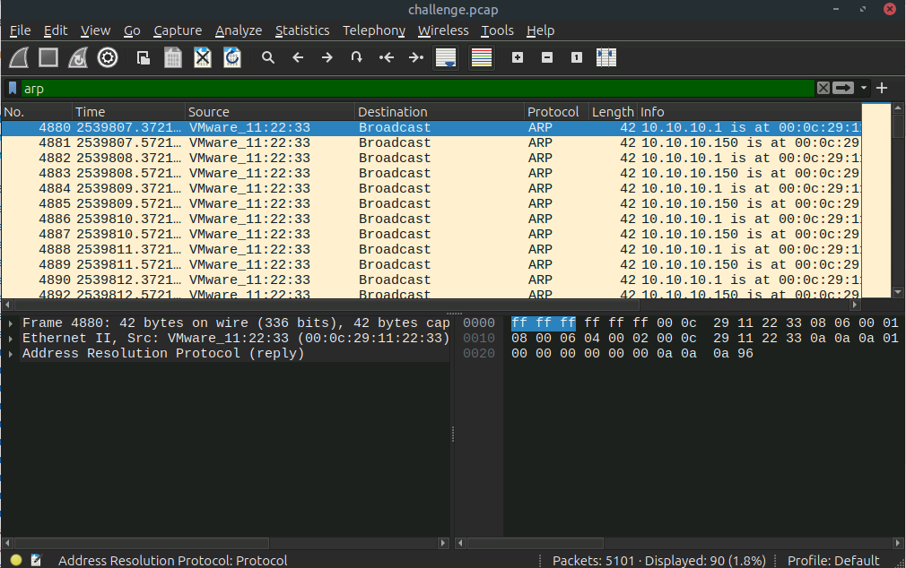
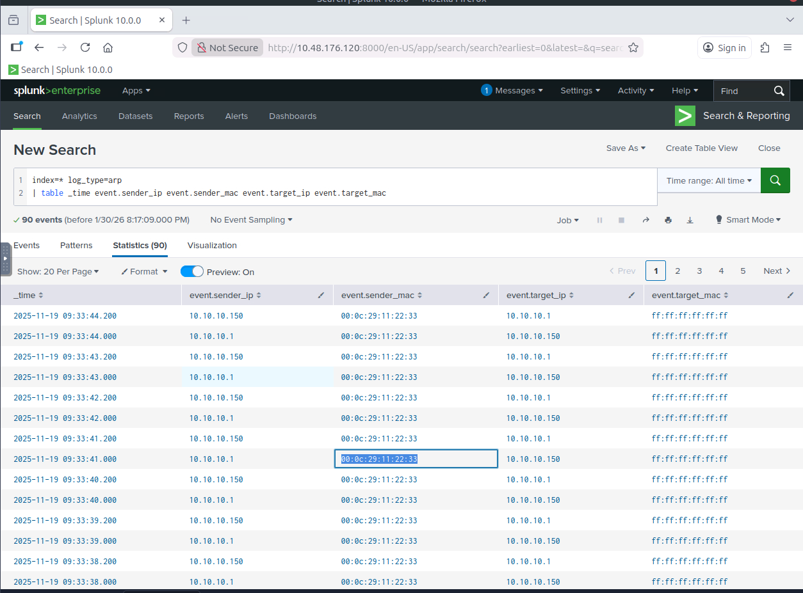
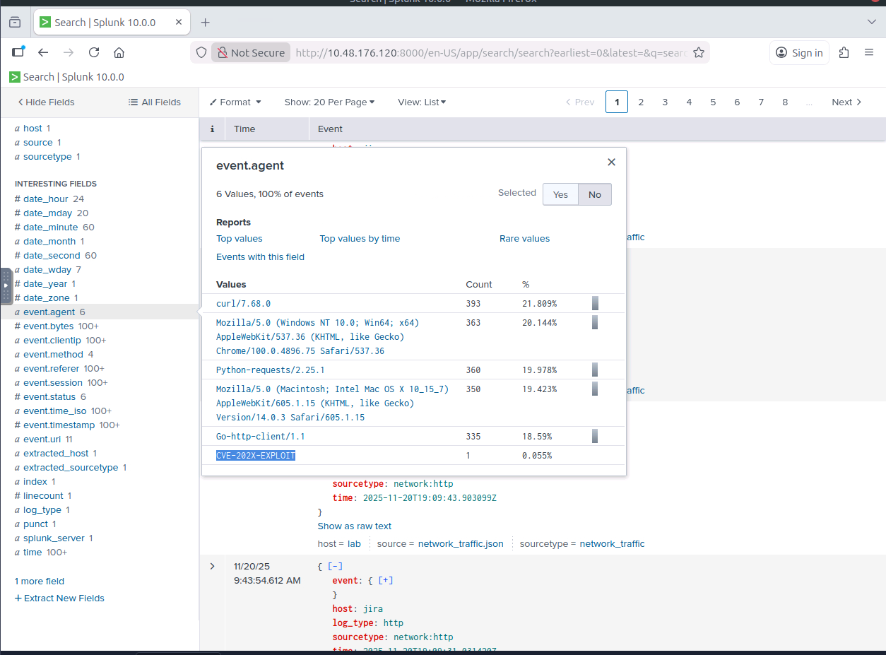
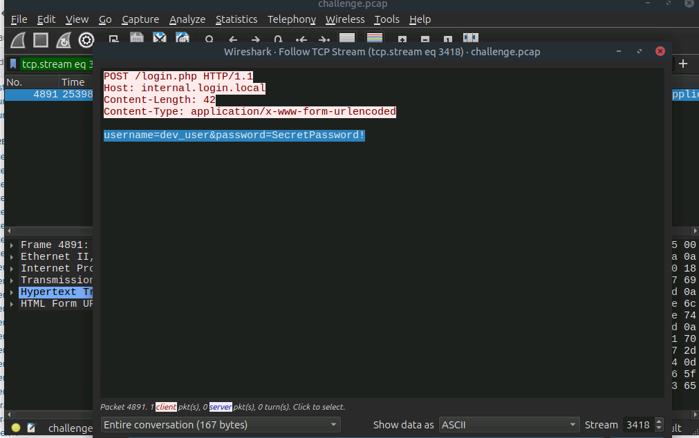
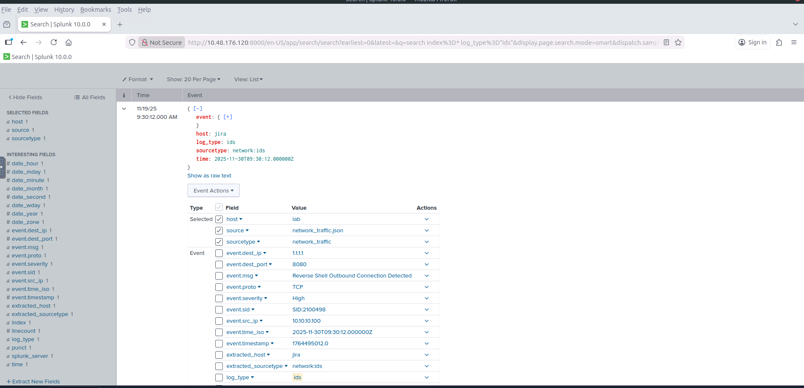
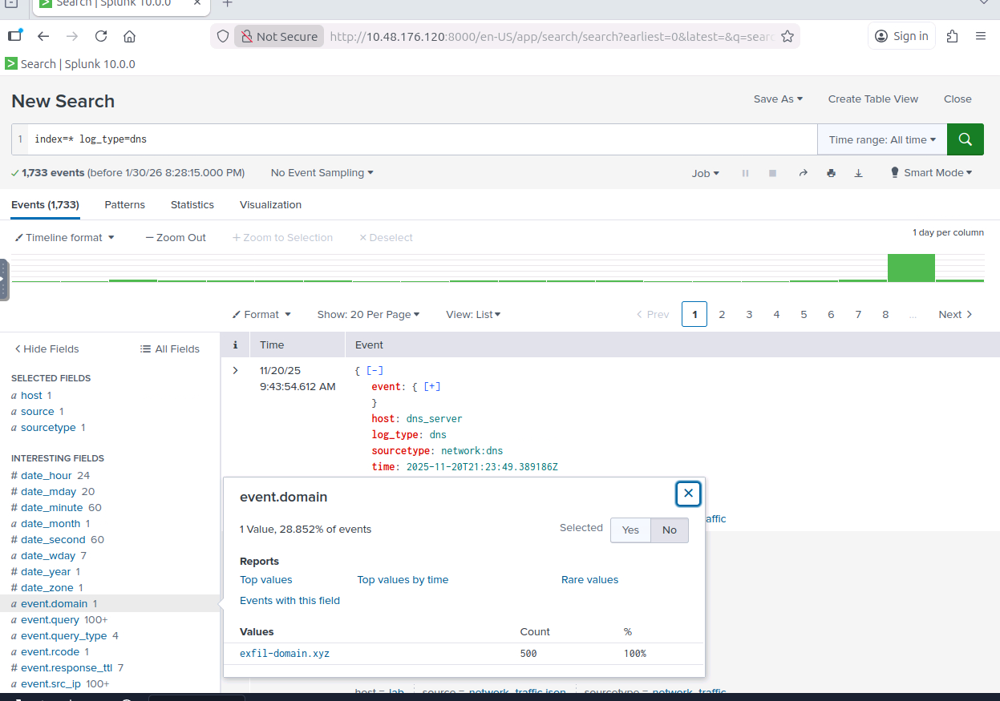

---
hide:
  - toc
---

<div class="soc-hero">

# 📡 Task 7: Network Forensics

<div class="soc-pill-row" style="margin-bottom: 1.2rem;">
  <span class="soc-pill">Alert: ARP Spoofing</span>
  <span class="soc-pill">Tool: Wireshark</span>
  <span class="soc-pill">Tactic: Credential Harvesting</span>
</div>

<span class="soc-muted">
Analysing a man-in-the-middle (MITM) attack. I found ARP poisoning used to intercept traffic, recovered cleartext credentials from the capture and identified a DNS exfiltration tunnel.
</span>

</div>

!!! abstract "Summary"
    **What happened:** A host with MAC `00:0c:29:11:22:33` poisoned ARP caches to impersonate the gateway (`10.10.10.1`), intercepted a cleartext HTTP login for `dev_user`, kept a reverse shell open from `10.10.10.100` and pushed data out through 500+ DNS queries to `exfil-domain.xyz`.

    **Impact:** Developer credentials stolen; data exfiltrated over DNS.

    **Key IOCs:** MAC `00:0c:29:11:22:33` · `10.10.10.100` · `exfil-domain.xyz` · User-Agent `CVE-202X-EXPLOIT`

!!! failure "🚨 IDS Alert: Suspicious Outbound Traffic"
    **Trigger:** Network IDS flagged a "Reverse Shell Outbound Connection" and anomalous ARP broadcasts.
    
    **Suspect Host:** `10.10.10.100`
    **Destination:** `1.1.1.1:8080`
    
    **Investigation Goal:** Analyze PCAP and Splunk logs to determine what data was intercepted.

---

## 🦈 Phase 1: Man-in-the-Middle (ARP Spoofing)

The attacker launched an ARP Spoofing attack to position themselves between the victims and the gateway.

=== "1. Wireshark Evidence"
    **Observation:** A flood of ARP replies claiming `10.10.10.1` (Gateway) and `10.10.10.150` (Victim) are at the **same MAC address**.
    
    * **Attacker MAC:** `00:0c:29:11:22:33`
    * **Impersonated IP:** `10.10.10.1`
    
    

=== "2. Splunk Stats"
    **Query:** `index=* log_type=arp | table _time sender_ip sender_mac target_ip target_mac`
    
    Splunk recorded **90 spoofing events**, confirming a sustained attack.
    
    

---

## 🔓 Phase 2: Credential Harvesting

With the traffic intercepted, the attacker captured unencrypted POST requests containing sensitive login information.

=== "1. Exploit Attempt"
    **Target:** Jira Instance
    **User-Agent:** `CVE-202X-EXPLOIT`
    
    The User-Agent string names an exploit outright. Real attackers usually hide behind normal browser strings, so a value like this is a gift to defenders: a simple User-Agent watchlist would catch it.
    
    

=== "2. Cleartext Creds"
    **PCAP Analysis:** Follow TCP Stream (Port 80).
    
    I recovered the following credentials from a captured HTTP POST request:
    
    * **URL:** `http://internal.login.local/login.php`
    * **Payload:** `username=dev_user&password=SecretPassword!`
    
    

---

## 📤 Phase 3: C2 & Exfiltration

Finally, I analysed how the attacker communicated externally and stole data.

=== "1. Reverse Shell"
    **IDS Alert:** `Reverse Shell Outbound Connection Detected`
    
    * **Source:** `10.10.10.100`
    * **Destination:** `1.1.1.1` (Port 8080)

    In the real world `1.1.1.1` is Cloudflare's public DNS resolver, so traffic to it on a non-DNS port like 8080 stands out as abnormal.
    
    This confirms the attacker has a live interactive session on the host.
    
    

=== "2. DNS Exfiltration"
    **Protocol:** DNS Tunneling
    
    I found high-frequency DNS queries to a suspicious domain. This technique hides data inside the subdomains of DNS requests (e.g., `encoded-data.exfil-domain.xyz`).
    
    * **Exfil Domain:** `exfil-domain.xyz`
    * **Count:** 500+ Queries
    
    

---

## 🔔 Detection Opportunities

!!! example "Detections I would add"
    These are example queries; index and field names depend on your environment.

    === "ARP spoofing"
        ```spl
        index=* log_type=arp
        | stats dc(sender_mac) AS macs values(sender_mac) AS mac_list BY sender_ip
        | where macs > 1
        ```
        One IP announced by more than one MAC address is the classic ARP poisoning signal.

    === "DNS tunnelling"
        ```spl
        index=dns
        | rex field=query "^(?<sub>.+)\.(?<domain>[^.]+\.[^.]+)$"
        | eval sub_len=len(sub)
        | stats count avg(sub_len) AS avg_len dc(sub) AS unique_subs BY src_ip domain
        | where count > 100 AND (avg_len > 30 OR unique_subs > 50)
        ```
        Lots of long, unique subdomains for one parent domain points to data hidden in DNS.

    === "Cleartext logins"
        ```spl
        index=network dest_port=80 http_method=POST
            (form_data="*password=*" OR uri_path="*login*")
        | table _time src_ip dest_ip uri_path
        ```

---

## 🛡️ Case Verdict

<div class="soc-grid">
  <div class="soc-card soc-case soc-accent-red">
    <div class="soc-card-body">
      <div class="soc-card-title">Network Compromise</div>
      <ul>
        <li><strong>Technique:</strong> ARP Spoofing (MITM)</li>
        <li><strong>Stolen Data:</strong> Dev Credentials (Cleartext)</li>
        <li><strong>Exfiltration:</strong> DNS Tunneling via <code>exfil-domain.xyz</code></li>
      </ul>
    </div>
  </div>

  <div class="soc-card soc-case soc-accent-green">
    <div class="soc-card-body">
      <div class="soc-card-title">Remediation Steps</div>
      <ul>
        <li>Enable <strong>Dynamic ARP Inspection (DAI)</strong> on switches.</li>
        <li>Force HTTPS for all internal login pages.</li>
        <li>Reset <code>dev_user</code> and isolate <code>10.10.10.100</code>.</li>
        <li>Block <code>exfil-domain.xyz</code> at the DNS resolver and only allow DNS through internal resolvers.</li>
        <li>Patch the Jira instance against the exploited CVE.</li>
      </ul>
    </div>
  </div>
</div>

<br>
<center>
  <a href="../task-6-Zero-Tolerance/" class="soc-btn">← Previous: Task 6</a>
  <a href="../../" class="soc-btn soc-btn-secondary">Return to Dashboard</a>
</center>