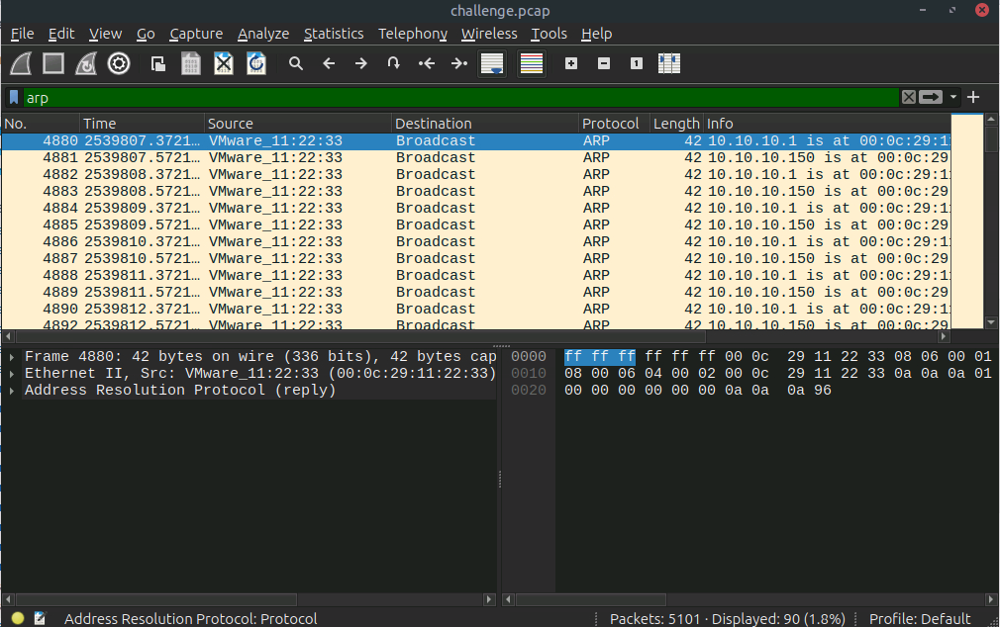
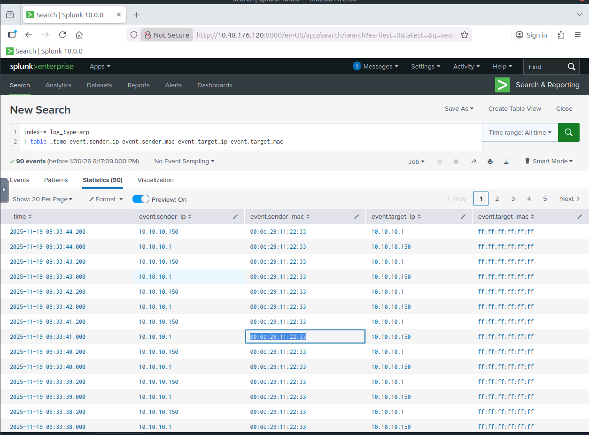
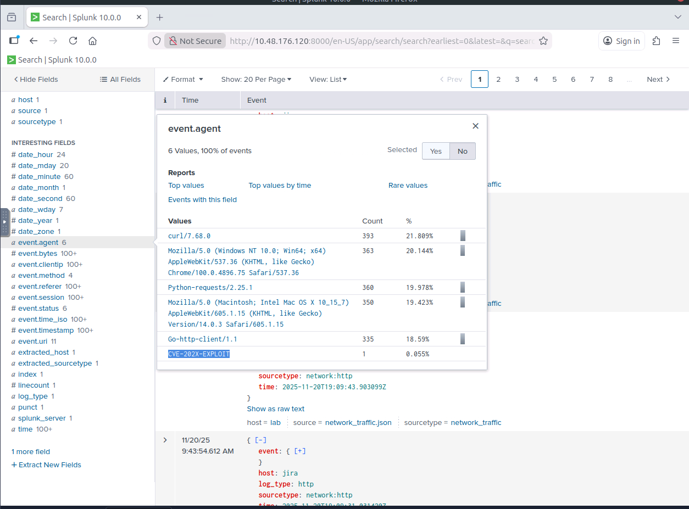
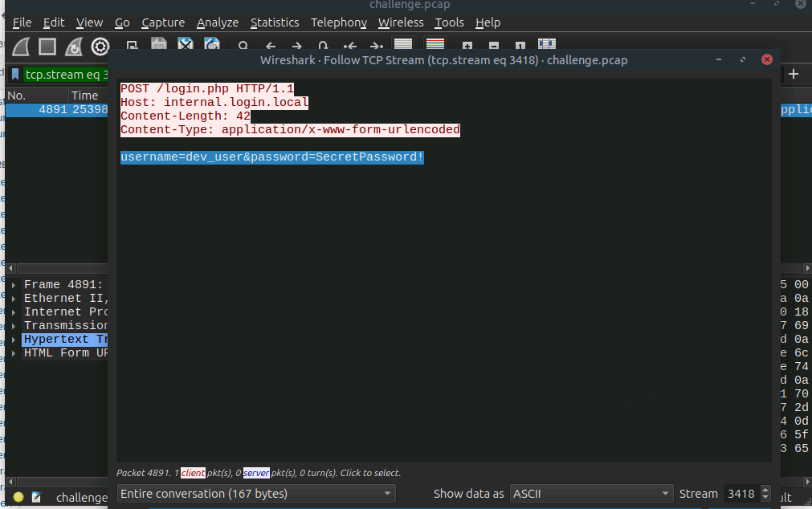
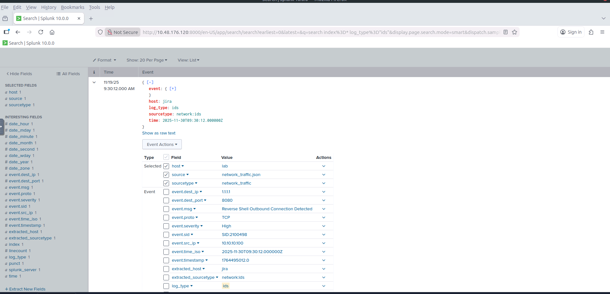
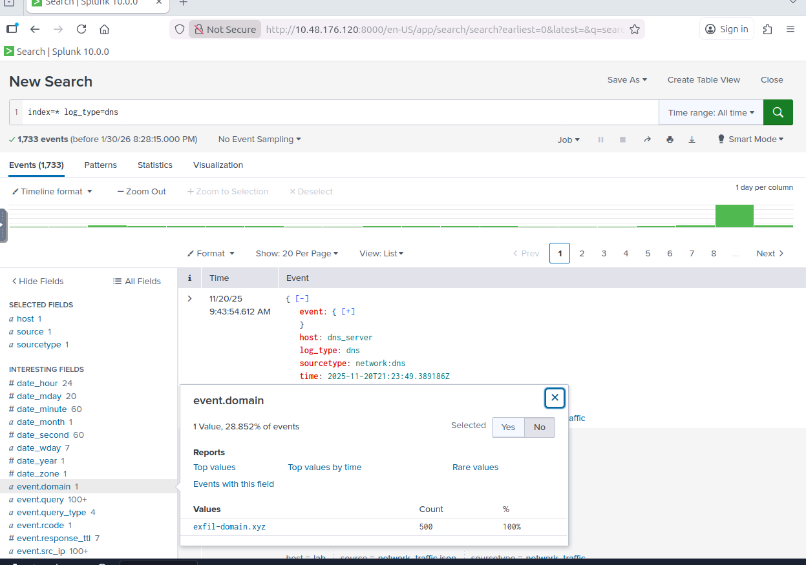

---
hide:
  - toc
---

# 📡 Task 7: Network Forensics

  Alert: ARP Spoofing
  Tool: Wireshark
  Tactic: Credential Harvesting

Analyzing a Man-in-the-Middle (MITM) attack. We detected ARP poisoning used to intercept traffic, captured cleartext credentials in transit, and identified a stealthy DNS exfiltration tunnel.

!!! failure "🚨 IDS Alert: Suspicious Outbound Traffic"
    **Trigger:** Network IDS flagged a "Reverse Shell Outbound Connection" and anomalous ARP broadcasts.
    
    **Suspect Host:** `10.10.10.100`
    **Destination:** `1.1.1.1:8080`
    
    **Investigation Goal:** Analyze PCAP and Splunk logs to determine what data was intercepted.

---

## 🦈 Phase 1: Man-in-the-Middle (ARP Spoofing)

The attacker launched an ARP Spoofing attack to position themselves between the victims and the gateway.

=== "1. Wireshark Evidence"
    **Observation:** A flood of ARP replies claiming `10.10.10.1` (Gateway) and `10.10.10.150` (Victim) are at the **same MAC address**.
    
    * **Attacker MAC:** `00:0c:29:11:22:33`
    * **Impersonated IP:** `10.10.10.1`
    
    

=== "2. Splunk Stats"
    **Query:** `index=* log_type=arp | table _time sender_ip sender_mac target_ip target_mac`
    
    Splunk recorded **90 spoofing events**, confirming a sustained attack.
    
    

---

## 🔓 Phase 2: Credential Harvesting

With the traffic intercepted, the attacker captured unencrypted POST requests containing sensitive login information.

=== "1. Exploit Attempt"
    **Target:** Jira Instance
    **User-Agent:** `CVE-202X-EXPLOIT`
    
    The attacker used a specifically crafted User-Agent, likely to trigger a known vulnerability or bypass filters.
    
    

=== "2. Cleartext Creds"
    **PCAP Analysis:** Follow TCP Stream (Port 80).
    
    We recovered the following credentials from a captured HTTP POST request:
    
    * **URL:** `http://internal.login.local/login.php`
    * **Payload:** `username=dev_user&password=SecretPassword!`
    
    

---

## 📤 Phase 3: C2 & Exfiltration

Finally, we analyzed how the attacker communicated externally and stole data.

=== "1. Reverse Shell"
    **IDS Alert:** `Reverse Shell Outbound Connection Detected`
    
    * **Source:** `10.10.10.100`
    * **Destination:** `1.1.1.1` (Port 8080)
    
    This confirms the attacker has a live interactive session on the host.
    
    

=== "2. DNS Exfiltration"
    **Protocol:** DNS Tunneling
    
    We detected high-frequency DNS queries to a suspicious domain. This technique hides data inside the subdomains of DNS requests (e.g., `encoded-data.exfil-domain.xyz`).
    
    * **Exfil Domain:** `exfil-domain.xyz`
    * **Count:** 500+ Queries
    
    

---

## 🛡️ Case Verdict

  

    

      
Network Compromise

      <ul>
        <li><strong>Technique:</strong> ARP Spoofing (MITM)</li>
        <li><strong>Stolen Data:</strong> Dev Credentials (Cleartext)</li>
        <li><strong>Exfiltration:</strong> DNS Tunneling via <code>exfil-domain.xyz</code></li>
      </ul>
    

  

  

    

      
Remediation Steps

      <ul>
        <li>Enable <strong>Dynamic ARP Inspection (DAI)</strong> on switches.</li>
        <li>Force HTTPS for all internal login pages.</li>
        <li>Block the domain <code>exfil-domain.xyz</code> at the DNS resolver.</li>
      </ul>
    

  

 

  <a href="../task-6-Zero-Tolerance/" class="soc-btn">← Previous: Task 6</a>
  <a href="../../" class="soc-btn soc-btn-secondary">Return to Dashboard</a>

