---
hide:
  - toc
---

<div class="soc-hero">

# 🎖️ Task 8: Promotion Night

<div class="soc-pill-row" style="margin-bottom: 1.2rem;">
  <span class="soc-pill">Alert: Ransomware</span>
  <span class="soc-pill">Tactic: Cloud Pivot</span>
  <span class="soc-pill">Ransomware: BabyLockerKZ</span>
</div>

<span class="soc-muted">
The final investigation. The attacker deployed ransomware on-premises, kept access through a scheduled task and a Run key, then used stolen AWS keys to steal backups from S3.
</span>

</div>

!!! abstract "Summary"
    **What happened:** `gaze.exe` was copied from the domain controller's SYSVOL share and run, encrypting files to `.danger17` and wiping free space with `cipher /w`. The attacker scanned `SRV-ITFS`, set up persistence, read `cloud-keys.csv`, logged in to AWS from `152.42.128.207`, downloaded two backup archives and left `YOU-HAVE-BEEN-PWNED.txt` in the bucket.

    **Impact:** On-premises files encrypted; cloud backups stolen (double extortion).

    **Key IOCs:** `gaze.exe` (MD5 `8BA3A306F5550374490030EA472F2F92`) · `.danger17` · `ruche.dll` · task `LanguageSync` · `152.42.128.207`

!!! failure "🚨 Critical Incident: Full Compromise"
    **Impact:** On-premises ransomware + theft of AWS backups
    **Ransom Extension:** `.danger17`
    
    **Narrative:** The attacker used `gaze.exe` to encrypt local files, then abused WMI for lateral movement. They then found a CSV file containing AWS keys, which let them pivot to the cloud, steal data and upload a ransom note.

---

## 🦠 Phase 1: Ransomware Deployment

The attack began with the execution of a binary named `gaze.exe`, which propagated itself via the Domain Controller's SYSVOL share.

=== "1. Distribution"
    **Mechanism:** The attacker copied the malware to the domain controller to ensure network-wide execution.
    
    **Command:**
    ```cmd
    cmd.exe /c copy \\DC-01\SYSVOL\gaze.exe C:\Windows\Temp\gaze.exe
    ```
    
    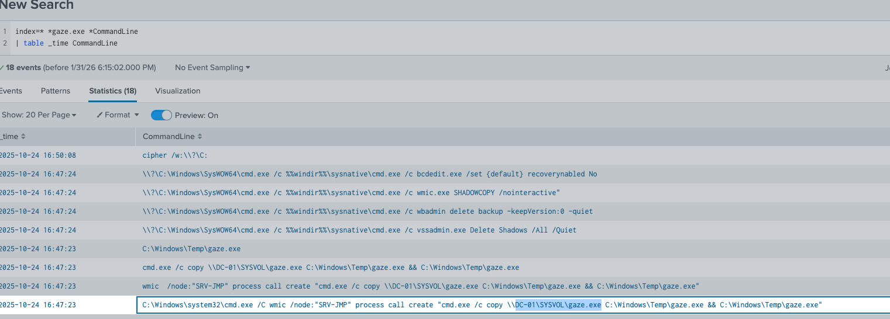

=== "2. Encryption Behavior"
    **Artifacts:** Files were encrypted with the extension `.danger17`.
    
    **Anti-Forensics:** I saw `cipher.exe /w` used to overwrite free disk space, so deleted original files cannot be recovered.
    
    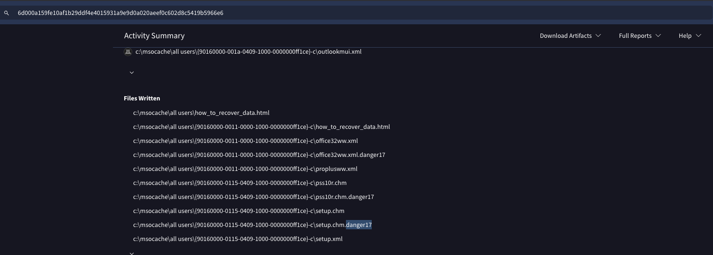

=== "3. Persistence"
    **Registry Value:** `BabyLockerKZ`

    BabyLockerKZ is the name public reporting (Cisco Talos) gives to a variant of the **MedusaLocker** ransomware family.
    
    The malware created a registry run key to ensure it executes on every reboot.
    
    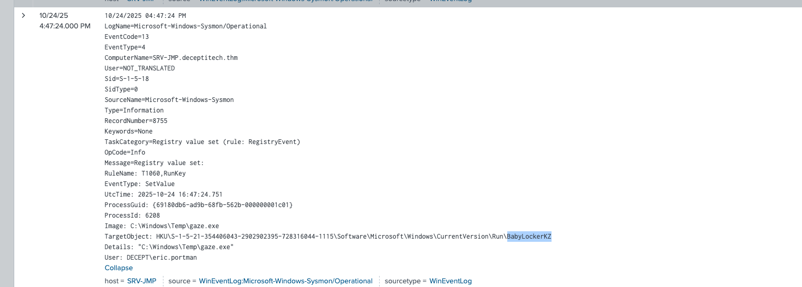

=== "4. Timeline"
    **Host:** `DESKTOP-J9PR0CO`
    
    A timeline analysis confirms the execution of `gaze.exe` followed by the `cipher` wipe command.
    
    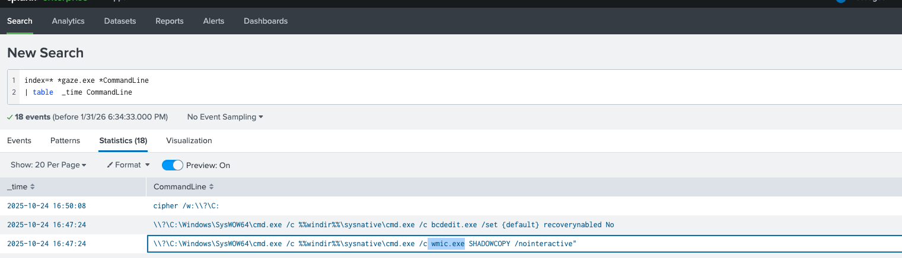

---

## 🔬 Phase 2: Malware Analysis (IOCs)

I pulled the sample's hashes from Sysmon process-creation logs (Event ID 1).

=== "1. Hash Analysis"
    **File:** `C:\Windows\Temp\gaze.exe` (run by `DECEPT\eric.portman` on `SRV-JMP`)

    * **MD5:** `8BA3A306F5550374490030EA472F2F92`
    * **SHA256:** `6D000A159FE10AF1B29DDF4E4015931A9E9D0A020AEEF0C602D8C5419B5966E6`
    * **Imphash:** `1CC690A422707DB94DD0913CD9980C27`
    
    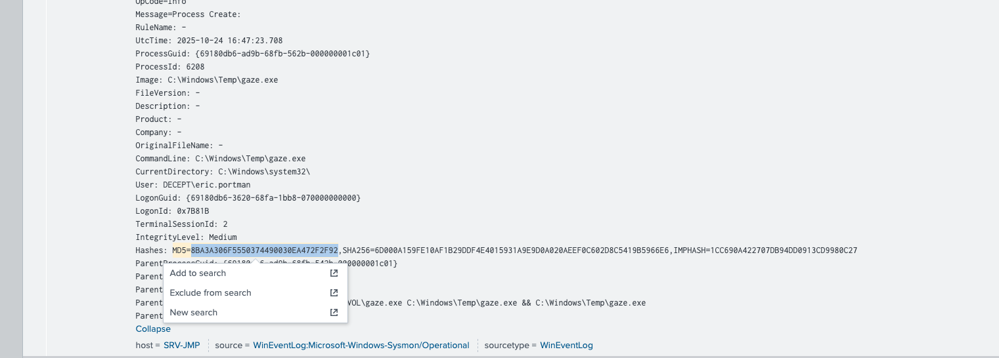

=== "2. Cipher Command"
    **Command:** `cipher /w:\\?\C:`
    
    This overwrites the free space on C:, destroying deleted files so investigators cannot recover the unencrypted originals.
    
    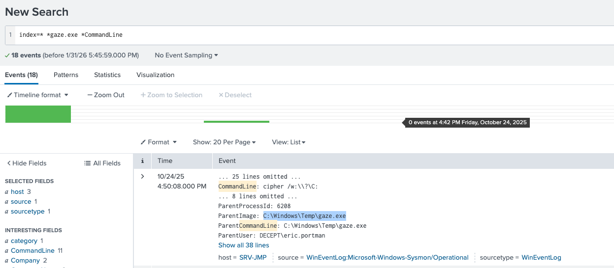

---

## 🕷️ Phase 3: Lateral Movement & Persistence

Once inside, the attacker used living-off-the-land techniques to scan the network and maintain access.

=== "1. WMI Scanning"
    **Technique:** T1047 (Windows Management Instrumentation)
    
    The attacker scanned `SRV-ITFS` on ports `135, 139, 445, 3389, 5985`.
    
    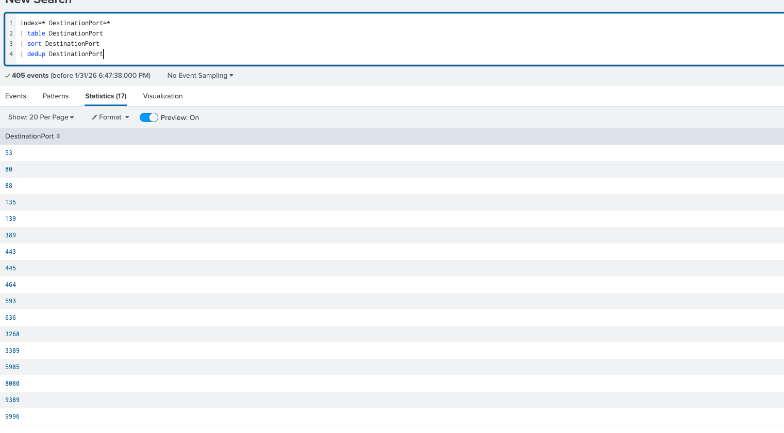

=== "2. MITRE Context"
    **Technique T1047:**
    Adversaries use WMI to execute malicious commands and payloads on remote systems.
    
    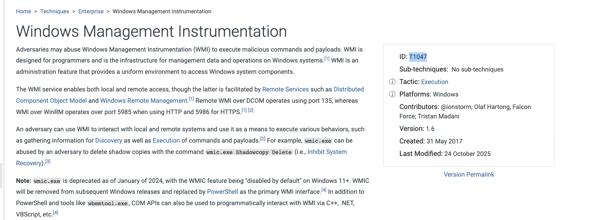

=== "3. Scheduled Task (XML)"
    **Task Name:** `LanguageSync`
    **Payload:** `C:\Windows\System32\fr-FR\ruche.dll`
    
    The persistence mechanism was disguised as a legitimate "LanguageSync" task executing a DLL.
    
    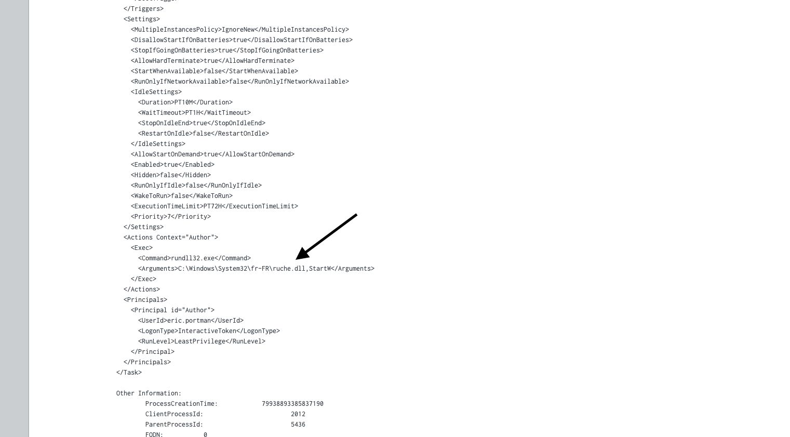

=== "4. Task Creation Log"
    **Event ID 4698:**
    This Windows Security Event confirms the creation of the scheduled task `LanguageSync`.
    
    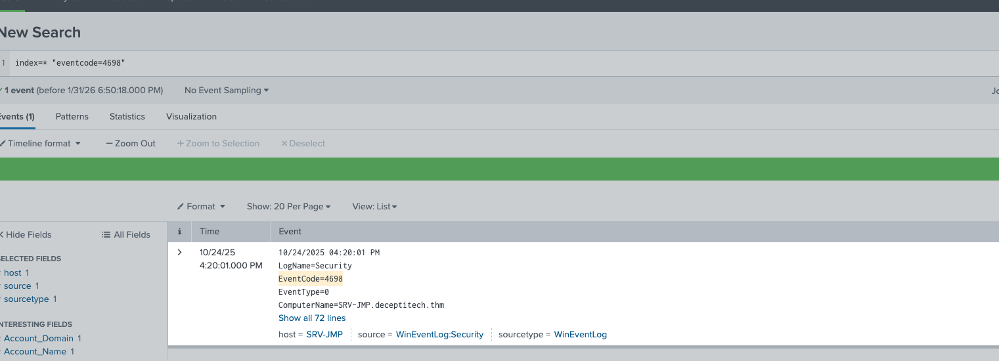

---

## ☁️ Phase 4: The Cloud Pivot

The most critical moment occurred when the attacker found a file containing cleartext cloud credentials.

=== "1. Credential Theft"
    **Source:** `\\SRV-ITFS\Integrations\cloud-keys.csv`
    
    Audit logs (Event 4663) show the attacker accessing this sensitive CSV file containing AWS keys.
    
    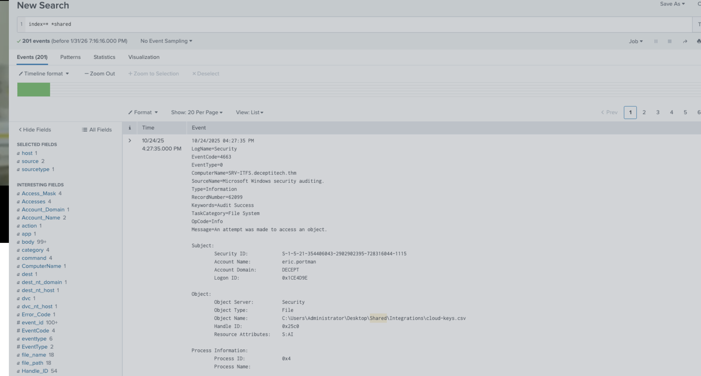

=== "2. AWS Access"
    **Source IP:** `152.42.128.207`
    
    Shortly after the CSV was read, I found a login to the AWS environment from this external IP.
    
    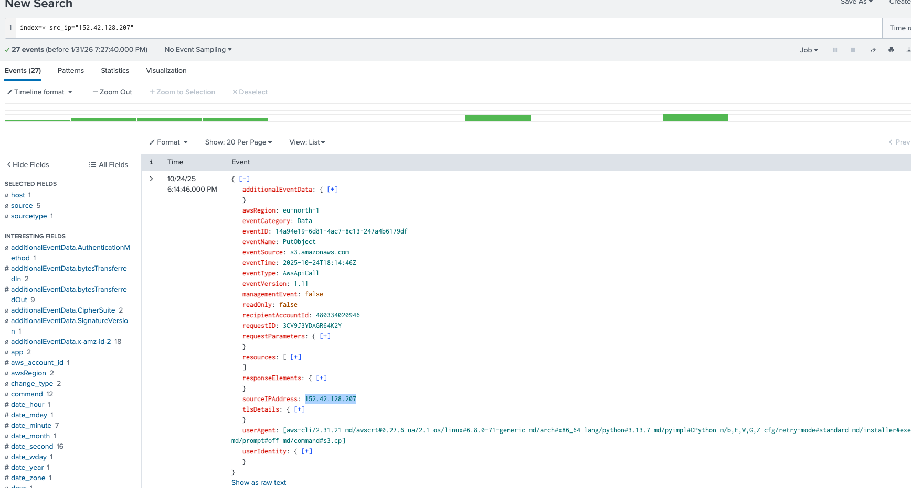

---

## 📤 Phase 5: Exfiltration & Defacement

With AWS access, the attacker stole critical data and left a message.

=== "1. Data Exfiltration"
    **Files Stolen:** `beta.tar.gz`, `latest.tar.gz`
    
    CloudTrail logs show `GetObject` events for these critical backup archives.
    
    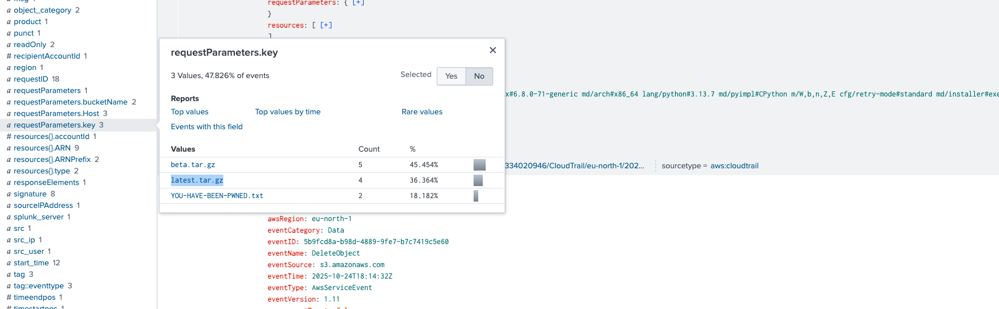

=== "2. Ransom Note"
    **Message:** `YOU-HAVE-BEEN-PWNED.txt`
    
    The attacker uploaded this note to the S3 bucket to prove access and pressure the victim.
    
    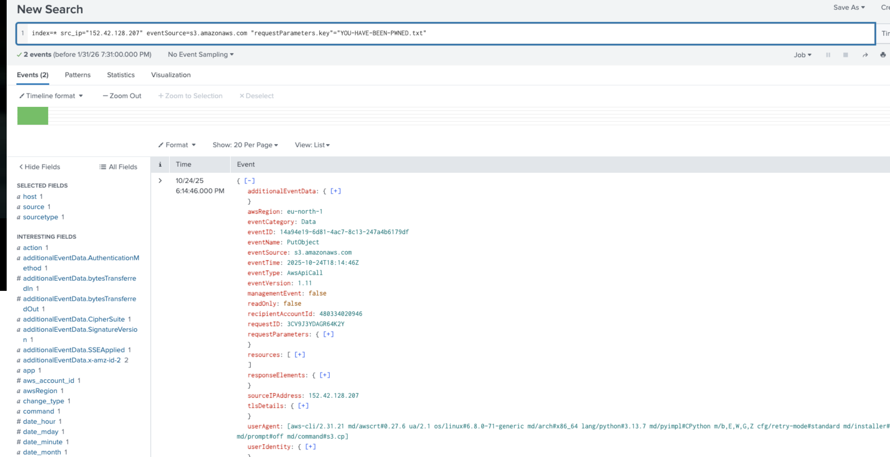

---

## 🔔 Detection Opportunities

!!! example "Detections I would add"
    These are example queries; index and field names depend on your environment.

    === "Free-space wipe"
        ```yaml
        title: Cipher used to wipe free space
        logsource: { product: windows, category: process_creation }
        detection:
          selection:
            Image|endswith: '\cipher.exe'
            CommandLine|contains: '/w'
          condition: selection
        level: high
        ```
        Legitimate use is rare; during an incident this is a strong ransomware signal.

    === "Executable copied from SYSVOL"
        ```spl
        index=sysmon EventCode=1 CommandLine="*SYSVOL*" CommandLine="*.exe*"
            (CommandLine="*copy*" OR CommandLine="*xcopy*")
        | table _time host User CommandLine
        ```

    === "Cloud keys used from a new IP"
        ```spl
        index=aws sourcetype=aws:cloudtrail
        | stats earliest(_time) AS first_seen values(eventName) AS actions BY userIdentity.accessKeyId sourceIPAddress
        | where first_seen > relative_time(now(), "-1d")
        ```
        Flags an access key appearing from an IP it has never used before.

---

## 🛡️ Case Verdict

<div class="soc-grid">
  <div class="soc-card soc-case soc-accent-red">
    <div class="soc-card-body">
      <div class="soc-card-title">Full Compromise (On-Prem + Cloud)</div>
      <ul>
        <li><strong>Ransomware:</strong> BabyLockerKZ (<code>gaze.exe</code>, <code>.danger17</code>)</li>
        <li><strong>Persistence:</strong> Run key + scheduled task <code>LanguageSync</code></li>
        <li><strong>Cloud:</strong> AWS keys from <code>cloud-keys.csv</code> used to steal S3 backups</li>
      </ul>
    </div>
  </div>

  <div class="soc-card soc-case soc-accent-green">
    <div class="soc-card-body">
      <div class="soc-card-title">Remediation Steps</div>
      <ul>
        <li>Disable and rotate the AWS keys; review CloudTrail for every action taken with them.</li>
        <li>Remove <code>gaze.exe</code> from SYSVOL, the Run key and the <code>LanguageSync</code> task.</li>
        <li>Restore from offline backups, and store backups where domain or cloud admin keys cannot delete them.</li>
        <li>Move secrets out of file shares into a secrets manager.</li>
      </ul>
    </div>
  </div>
</div>

<br>
<center>
  <a href="../task-7-The-Crown-Jewel/" class="soc-btn">← Previous: Task 7</a>
  
  <a href="../" class="soc-btn soc-btn-secondary">Back to Dashboard</a>
</center>