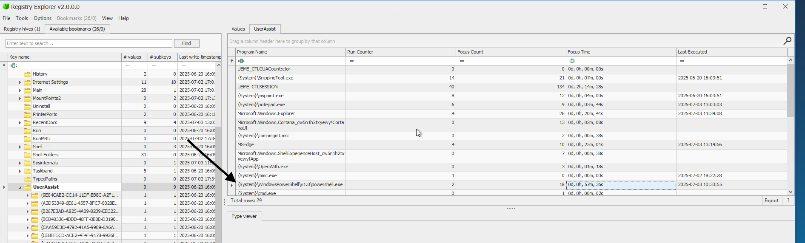
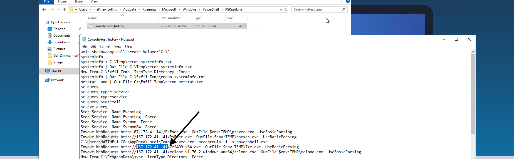
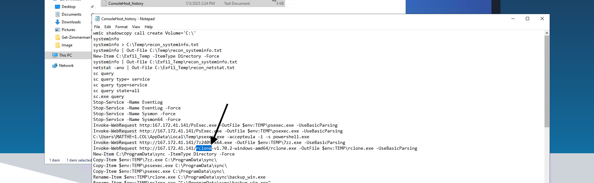
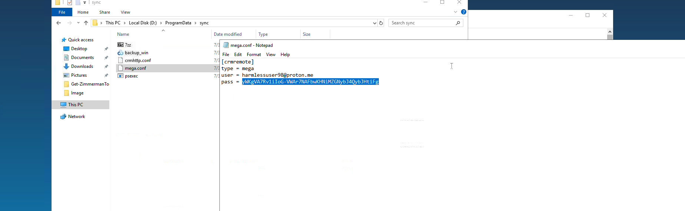
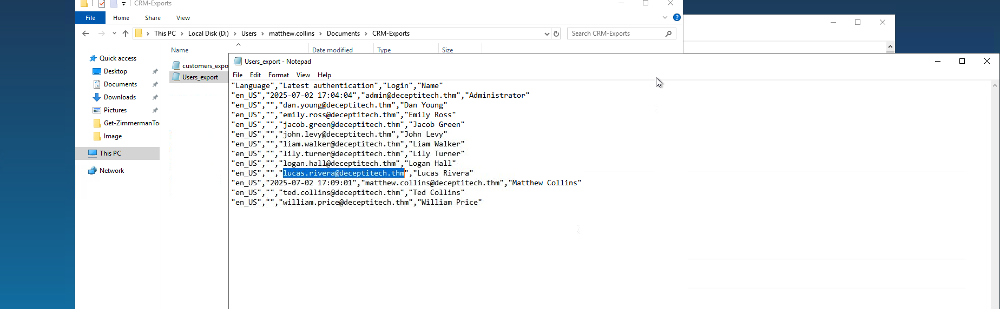

---
hide:
  - toc
---

<div class="soc-hero">

# 💾 Task 4: CRM Snatch

<div class="soc-pill-row" style="margin-bottom: 1.2rem;">
  <span class="soc-pill">Tool: Registry Explorer</span>
  <span class="soc-pill">Tactic: Exfiltration</span>
  <span class="soc-pill">Technique: Data Staging</span>
</div>

<span class="soc-muted">
Investigating the disk image of the compromised workstation. I analysed user artefacts to identify the account used for lateral movement and the tools used to steal sensitive CRM data.
</span>

</div>

!!! abstract "Summary"
    **What happened:** The attacker used `matthew.collins` to open a PowerShell session for about 57 minutes, downloaded Rclone from `167.172.41.141` and uploaded a CRM user export to an attacker-controlled Mega account.

    **Impact:** Exfiltration of employee personal data (names, emails) from the CRM.

    **Key IOCs:** `167.172.41.141` · `rclone-v1.70.2-windows-amd64` · `mega.conf`

!!! failure "🚨 Security Alert: Data Exfiltration Detected"
    **Trigger:** High-volume outbound traffic detected from a workstation to a known cloud storage provider.
    
    **Initial Assessment:** The attacker compromised a domain user account, staged sensitive corporate data, and utilized a command-line tool to upload it to external storage.
    
    **Investigation Goal:** Identify the compromised account, the C2 infrastructure, the exfiltration tool, and the scope of the data breach.

---

## 👤 Phase 1: User Forensic Analysis

I began with the `NTUSER.DAT` hive and PowerShell history files to determine which account was compromised and how long the attacker was active.

=== "Account Identification"
    **Action:** I located the PowerShell history file (`ConsoleHost_history.txt`). Its path shows which user profile ran the commands.
    
    

=== "Session Duration"
    **Action:** Analyzing the **UserAssist** registry key (`NTUSER.DAT`) to calculate the execution time of `powershell.exe`.
    
    

=== "Findings"
    **Account used:** `matthew.collins`, the account whose hash was dumped on the previous host (path `C:\Users\matthew.collins\...`).

    **PowerShell session length:** UserAssist records a focus time of `0d, 0h, 57m, 35s` for `powershell.exe`, which is (57 × 60) + 35 = **3455 seconds**.

    Focus time counts how long the window was in the foreground, so it is a close estimate of hands-on-keyboard time rather than an exact session length.

---

## 📡 Phase 2: C2 Infrastructure & Tooling

The PowerShell history revealed the commands used to download exfiltration tools from an external Command and Control (C2) server.

=== "Download Commands"
    **Action:** Reviewing the `ConsoleHost_history.txt` content revealed `Invoke-WebRequest` calls used to fetch tools.
    
    

=== "Findings"
    **Evidence:** The URL `http://167.172.41.141/rclone...` was used to download the malicious toolkit.
    
    **Finding:** `167.172.41.141`
    
    **Evidence:** The filename `rclone-v1.70.2-windows-amd64` confirms the use of **Rclone**, a command-line program to manage files on cloud storage.
    
    **Finding:** `Rclone`

---

## ☁️ Phase 3: Exfiltration Configuration

I examined the configuration files left behind by the attacker to understand where the data was sent.

=== "Rclone Config"
    **Action:** I found `mega.conf` in the staging directory, used by Rclone to authenticate with the cloud provider.
    
    

=== "Credentials"
    **Evidence:** The config holds the password for the `mega` remote in Rclone's "obscured" format. This is encoding, not encryption: `rclone reveal` turns it back into plain text, so investigators can log in to the attacker's account and see what was uploaded.
    
    **Finding:** `yWKgVA7Rv1iIoG-VWAr7NAFbwKHNiMZGNybJ4QybJHtiFg`

---

## 📉 Phase 4: Impact Assessment

Finally, I analysed the staged files to determine exactly what data was stolen from the CRM system.

=== "Stolen Data"
    **Action:** Opening the `Users_export` file found in the staging folder revealed a list of employee details.
    
    

=== "Victim Identification"
    **Evidence:** The CSV export lists user details, specifically the entry for `Lucas Rivera`.
    
    **Finding:** `lucas.rivera@deceptitech.thm`

---

## 🔔 Detection Opportunities

!!! example "Detections I would add"
    These are example queries; index and field names depend on your environment.

    === "Rclone execution"
        ```yaml
        title: Rclone used to copy data to cloud storage
        logsource: { product: windows, category: process_creation }
        detection:
          selection_name:
            - Image|endswith: '\rclone.exe'
            - OriginalFileName: 'rclone.exe'
          selection_renamed:
            CommandLine|contains|all: ['--config', 'mega']
          condition: selection_name or selection_renamed
        level: high
        ```

    === "Tools downloaded by PowerShell"
        ```spl
        index=wineventlog EventCode=4104 ScriptBlockText="*Invoke-WebRequest*"
        | rex field=ScriptBlockText "(?<url>https?://[^\s'\"]+)"
        | table _time host user url
        ```

    === "Traffic to file-sharing sites"
        ```spl
        index=proxy (dest_host="*mega.nz" OR dest_host="*mega.co.nz" OR dest_host="*mega.io")
        | stats sum(bytes_out) AS bytes_out BY src_ip user
        | where bytes_out > 50000000
        ```

---

## 🛡️ Case Verdict

<div class="soc-grid">
  <div class="soc-card soc-case soc-accent-red">
    <div class="soc-card-body">
      <div class="soc-card-title">Exfiltration Summary</div>
      <ul>
        <li><strong>Compromised User:</strong> matthew.collins</li>
        <li><strong>Tool:</strong> Rclone (to Mega.nz)</li>
        <li><strong>C2 Node:</strong> 167.172.41.141</li>
      </ul>
    </div>
  </div>

  <div class="soc-card soc-case soc-accent-green">
    <div class="soc-card-body">
      <div class="soc-card-title">Remediation & Next Steps</div>
      <div class="soc-card-desc">
        Data theft is confirmed: the CRM user export was sent to Mega. Block <code>167.172.41.141</code> and Mega domains, disable <code>matthew.collins</code>, and prepare a breach notification for the exposed employees. The file system is analysed next to find the ransomware itself.
      </div>
    </div>
  </div>
</div>

<br>
<center>
  <a href="../task-3-memory-forensics/" class="soc-btn">← Previous: Task 3</a>
  <a href="../task-5-file-system/" class="soc-btn soc-btn-secondary">Next: Task 5 (File System) →</a>
</center>