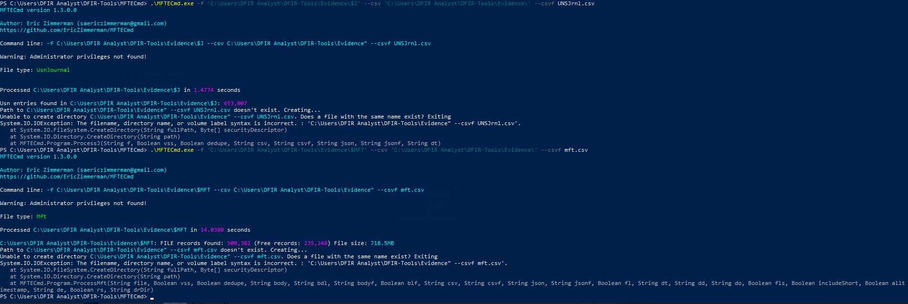
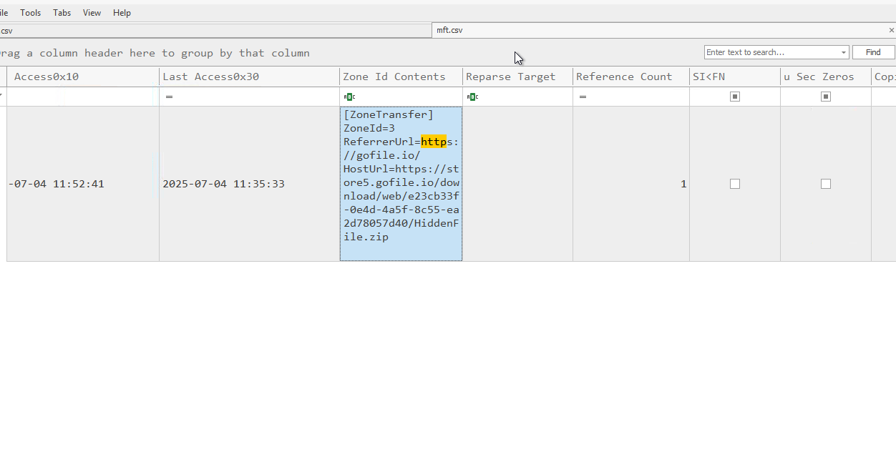
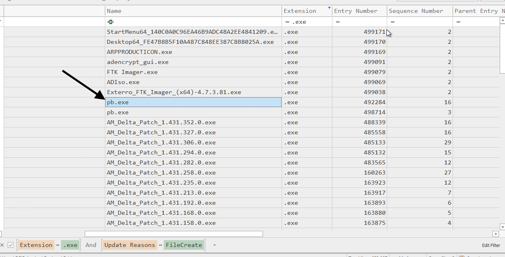
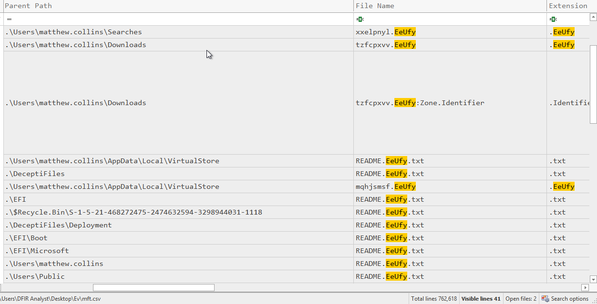
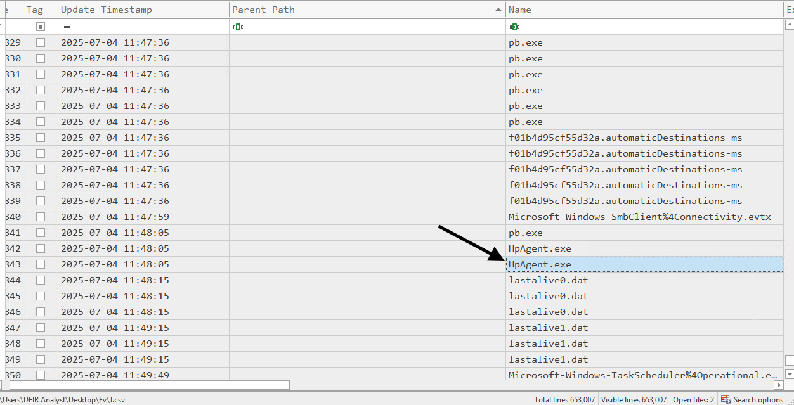
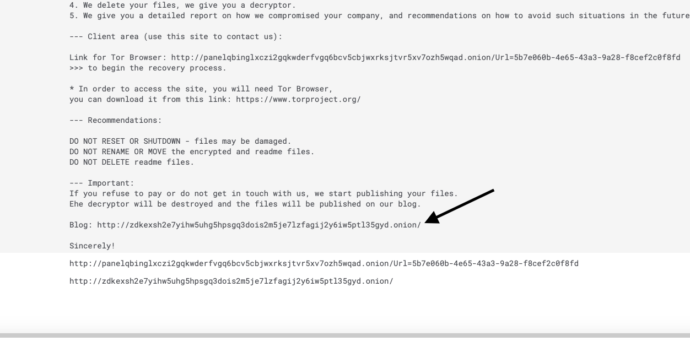

---
hide:
  - toc
---

# 🌩️ Task 5: Shock and Silence

  Tool: MFTECmd
  Tactic: Impact
  Malware: BlackLock

Analyzing the Master File Table (MFT) and file system artifacts to reconstruct the ransomware deployment. We trace the payload from download to execution and encryption.

!!! failure "🚨 Security Alert: Ransomware Detonation"
    **Trigger:** Widespread file modification and creation of ransom notes detected across the file system.
    
    **Initial Assessment:** The attacker successfully downloaded a payload, renamed it to evade detection, and executed a crypto-ransomware strain that appended a unique extension to victim files.
    
    **Investigation Goal:** Identify the delivery URL, the specific malware executable, and the threat actor responsible.

---

## 📥 Phase 1: Delivery & Download

We started by parsing the `$MFT` (Master File Table) using `MFTECmd` to find evidence of file downloads. The `Zone.Identifier` Alternate Data Stream (ADS) often contains the source URL of downloaded files.

=== "MFT Parsing"
    **Action:** Processing the MFT to extract metadata about recently created files.
    
    

=== "Source Identification"
    **Question:** What is the full URL from which the ransomware was downloaded to the system?
    
    **Evidence:** The `Zone.Identifier` contents for a suspicious zip file reveal it was downloaded from a file-sharing site.
    
    
    
    **Answer:** `https://store5.gofile.io/download/web/e23cb33f-0e4d-4a5f-8c55-ea2d78057d40/HiddenFile.zip`

---

## 🎭 Phase 2: Payload Identification

After downloading the archive, the attacker extracted and renamed the executable to blend in. We used timeline analysis to find the original filename.

=== "File Timeline"
    **Action:** Analyzing the creation events in the download directory.
    
    

=== "Findings"
    **Question:** What was the original file name of the ransomware executable downloaded to the host?
    
    **Evidence:** The file timeline shows the creation of `pb.exe` immediately following the download.
    
    **Answer:** `pb.exe`

---

## ⚙️ Phase 3: Execution & Encryption

The attacker did not run `pb.exe` directly for the encryption phase. Instead, they utilized another executable to perform the actual locking of files.

=== "Execution Artifacts"
    **Action:** Correlating the timestamp of file encryption with running processes.
    
    

=== "Process ID"
    **Question:** Which executable file initiated the encryption process on the system?
    
    **Evidence:** The timeline shows `HpAgent.exe` active exactly when the files began to be modified.
    
    **Answer:** `HpAgent.exe`

---

## 🔒 Phase 4: Impact Analysis

We examined the file system to determine the scope of the damage and the specific indicators of compromise (IOCs).

=== "Encrypted Files"
    **Action:** Listing files in the user's directory revealed the extension appended by the malware.
    
    

=== "Extension"
    **Question:** What file extension was appended to the encrypted files?
    
    **Evidence:** All user files have been renamed with the `.EeUfy` extension.
    
    **Answer:** `EeUfy`

---

## 🏴‍☠️ Phase 5: Attribution

Finally, we analyzed the ransom note left behind to identify the threat actor.

=== "Ransom Note"
    **Action:** Opening the `README.txt` file found in the encrypted directories.
    
    

=== "Group Identity"
    **Question:** Go beyond the obvious - which ransomware group targeted the organisation?
    
    **Evidence:** The onion URL and the specific formatting of the note are characteristic of the **BlackLock** ransomware group.
    
    **Answer:** `BlackLock`

---

## 🛡️ Case Verdict

  

    

      
Ransomware Profile

      <ul>
        <li><strong>Group:</strong> BlackLock</li>
        <li><strong>Payload:</strong> HpAgent.exe (renamed/injected)</li>
        <li><strong>Extension:</strong> .EeUfy</li>
        <li><strong>Delivery:</strong> Gofile.io (Manual Download)</li>
      </ul>
    

  

  

    

      
Investigation Status

      

        The ransomware attack is fully mapped. The final task is to investigate the <strong>MacOS</strong> laptop to see if any data was exfiltrated there as well.
      

    

  

 

  <a href="../task-4-disk-forensics/" class="soc-btn">← Previous: Task 4</a>
  <a href="../task-6-macos/" class="soc-btn soc-btn-secondary">Next: Task 6 (MacOS Forensics) →</a>

