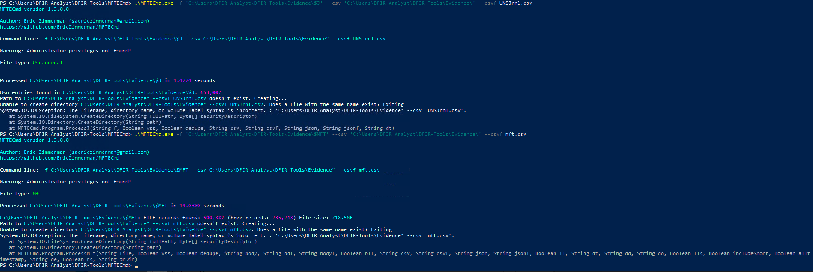
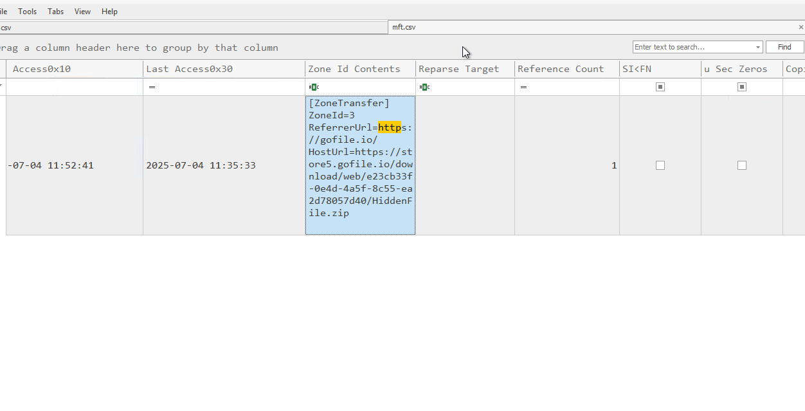
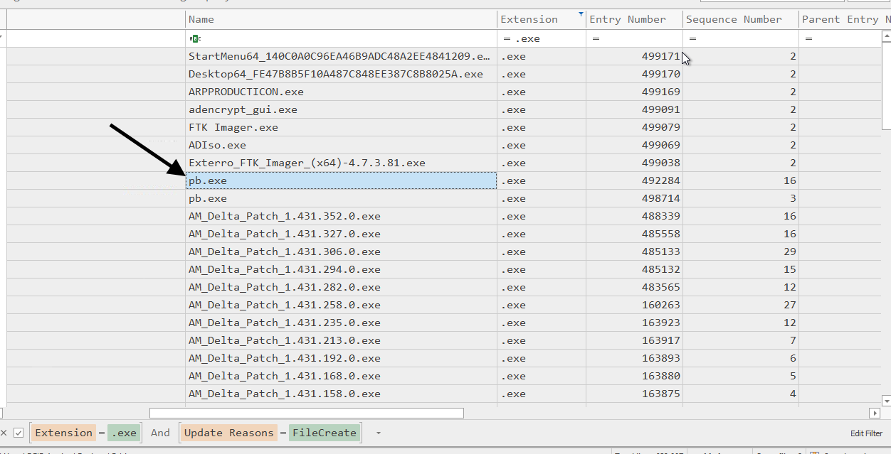
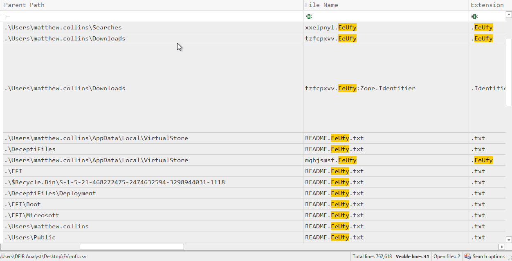
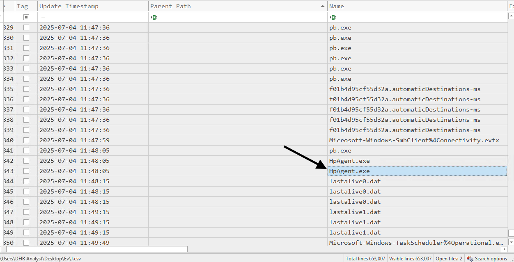
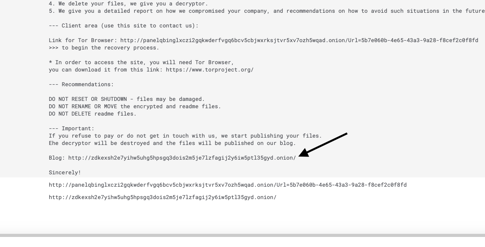

---
hide:
  - toc
---

<div class="soc-hero">

# 🌩️ Task 5: Shock and Silence

<div class="soc-pill-row" style="margin-bottom: 1.2rem;">
  <span class="soc-pill">Tool: MFTECmd</span>
  <span class="soc-pill">Tactic: Impact</span>
  <span class="soc-pill">Malware: BlackLock</span>
</div>

<span class="soc-muted">
Analyzing the Master File Table (MFT) and file system artifacts to reconstruct the ransomware deployment. I traced the payload from download to execution and encryption.
</span>

</div>

!!! abstract "Summary"
    **What happened:** `HiddenFile.zip` was downloaded from `gofile.io`, giving the ransomware `pb.exe`. `HpAgent.exe` then encrypted user files with the `.EeUfy` extension and dropped `README.txt` ransom notes. The note's onion site and format match the BlackLock ransomware group.

    **Impact:** Files encrypted across the host, on top of the data already stolen (double extortion).

    **Key IOCs:** `store5.gofile.io/.../HiddenFile.zip` · `pb.exe` · `HpAgent.exe` · `.EeUfy`

!!! failure "🚨 Security Alert: Ransomware Detonation"
    **Trigger:** Widespread file modification and creation of ransom notes detected across the file system.
    
    **Initial Assessment:** The attacker successfully downloaded a payload, renamed it to evade detection, and executed a crypto-ransomware strain that appended a unique extension to victim files.
    
    **Investigation Goal:** Identify the delivery URL, the specific malware executable, and the threat actor responsible.

---

## 📥 Phase 1: Delivery & Download

I started by parsing the `$MFT` (Master File Table) using `MFTECmd` to find evidence of file downloads. Windows adds a `Zone.Identifier` alternate data stream (the "Mark of the Web") to downloaded files, and it often records the source URL.

=== "MFT Parsing"
    **Action:** Processing the MFT to extract metadata about recently created files.
    
    

=== "Source Identification"
    **Evidence:** The `Zone.Identifier` contents for a suspicious zip file reveal it was downloaded from a file-sharing site.
    
    
    
    **Finding:** `https://store5.gofile.io/download/web/e23cb33f-0e4d-4a5f-8c55-ea2d78057d40/HiddenFile.zip`

---

## 🎭 Phase 2: Payload Identification

After downloading the archive, the attacker extracted and renamed the executable to blend in. I used timeline analysis to find the original filename.

=== "File Timeline"
    **Action:** Analyzing the creation events in the download directory.
    
    

=== "Findings"
    **Evidence:** The file timeline shows the creation of `pb.exe` immediately following the download.
    
    **Finding:** `pb.exe`

---

## ⚙️ Phase 3: Execution & Encryption

The attacker did not run `pb.exe` directly for the encryption phase. Instead, they utilized another executable to perform the actual locking of files.

=== "Execution Artifacts"
    **Action:** Correlating the timestamp of file encryption with running processes.
    
    

=== "Process ID"
    **Evidence:** The timeline shows `HpAgent.exe` active exactly when the files began to be modified.
    
    **Finding:** `HpAgent.exe`

---

## 🔒 Phase 4: Impact Analysis

I examined the file system to determine the scope of the damage and the specific indicators of compromise (IOCs).

=== "Encrypted Files"
    **Action:** Listing files in the user's directory revealed the extension appended by the malware.
    
    

=== "Extension"
    **Evidence:** All user files have been renamed with the `.EeUfy` extension.
    
    **Finding:** `EeUfy`

---

## 🏴‍☠️ Phase 5: Attribution

Finally, I analysed the ransom note to identify the group behind the attack.

=== "Ransom Note"
    **Action:** Opening the `README.txt` file found in the encrypted directories.
    
    

=== "Group Identity"
    **Evidence:** The onion URL and the specific formatting of the note are characteristic of the **BlackLock** ransomware group.
    
    **Finding:** `BlackLock`

---

## 🔔 Detection Opportunities

!!! example "Detections I would add"
    These are example queries; index and field names depend on your environment.

    === "Mass file renames"
        ```spl
        index=sysmon EventCode=11 TargetFilename="*.EeUfy"
        | bin _time span=1m
        | stats count BY _time host Image
        | where count > 100
        ```
        In practice, alert on any process creating hundreds of files with the same new extension in a minute.

    === "Executables from file-sharing sites"
        ```spl
        index=sysmon EventCode=15
            (Contents="*gofile.io*" OR Contents="*mega.nz*" OR Contents="*transfer.sh*")
        | table _time host TargetFilename Contents
        ```
        Sysmon Event 15 captures `Zone.Identifier` streams, including the download URL.

    === "Ransom notes appearing"
        ```spl
        index=sysmon EventCode=11 TargetFilename="*\\README.txt"
        | stats dc(TargetFilename) AS notes BY host Image
        | where notes > 20
        ```

---

## 🛡️ Case Verdict

<div class="soc-grid">
  <div class="soc-card soc-case soc-accent-red">
    <div class="soc-card-body">
      <div class="soc-card-title">Ransomware Profile</div>
      <ul>
        <li><strong>Group:</strong> BlackLock</li>
        <li><strong>Payload:</strong> <code>pb.exe</code> from <code>HiddenFile.zip</code>; encryption run by <code>HpAgent.exe</code></li>
        <li><strong>Extension:</strong> .EeUfy</li>
        <li><strong>Delivery:</strong> Gofile.io (Manual Download)</li>
      </ul>
    </div>
  </div>

  <div class="soc-card soc-case soc-accent-green">
    <div class="soc-card-body">
      <div class="soc-card-title">Remediation & Next Steps</div>
      <div class="soc-card-desc">
        Isolate affected hosts, restore from offline backups, block <code>gofile.io</code> downloads, and hunt for <code>HpAgent.exe</code> and <code>.EeUfy</code> files on every endpoint. The final step is the CEO's <strong>macOS</strong> laptop, to check for further data theft.
      </div>
    </div>
  </div>
</div>

<br>
<center>
  <a href="../task-4-disk-forensics/" class="soc-btn">← Previous: Task 4</a>
  <a href="../task-6-macos/" class="soc-btn soc-btn-secondary">Next: Task 6 (MacOS Forensics) →</a>
</center>